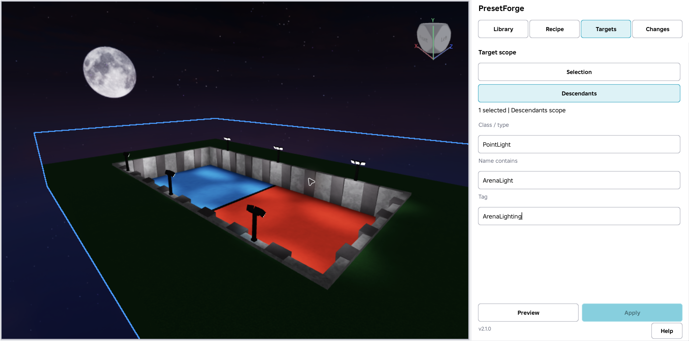
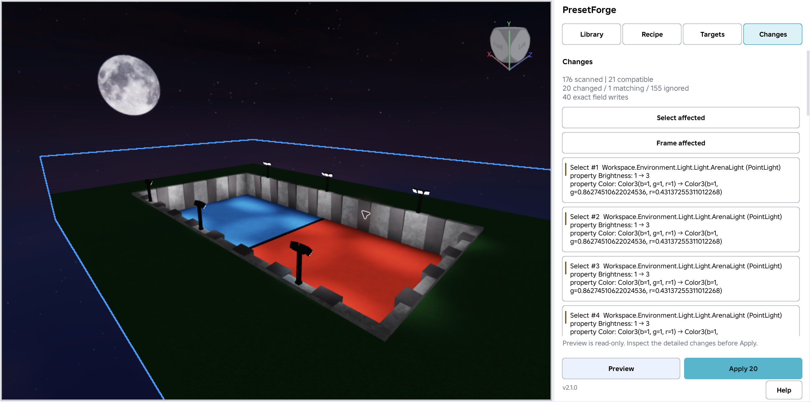
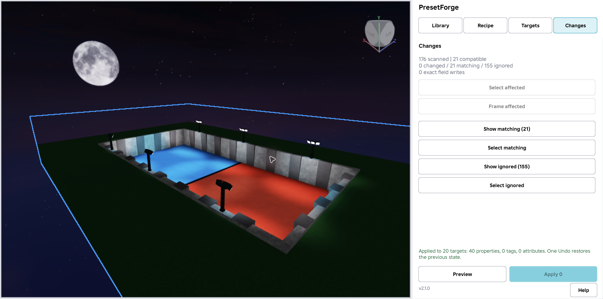

# PresetForge 2.1.0 - Community Resources update draft

Prepared **2026-09-27** for [issue #16](https://github.com/francoisdebono8-rgb/roblox-dev/issues/16). **DRAFT: native acceptance passed and Studio successfully submitted 2.1.0 to the canonical asset. Nothing was posted.** Evidence: [release gate](../../products/presetforge/v2/RELEASE_GATE.md). Before posting, the user must confirm customer availability, website listing and posting permission.

- Submitted version: **2.1.0**, a UX iteration on the existing engine and property whitelist.
- Price: **USD 4.99**. Reconfirm the live listing before a future announcement.
- Canonical asset: [PresetForge - Safe Bulk Editor, 73596873703054](https://create.roblox.com/store/asset/73596873703054). Update that asset only; the existing listing does not prove this version is available.
- Destination: our own PresetForge topic in [Community Resources](https://devforum.roblox.com/c/resources/community-resources/74), if one exists and can be updated. Otherwise use one dedicated product topic with an appropriate plugin tag after posting is explicitly authorized. Own-topic URL and account permissions were not verified in this task.
- Research and tailored replies: [PresetForge opportunities](devforum-opportunities.md#presetforge). Strongest candidate: 1164752. Thread 3576978 is a reserve requiring independently renewed need; other examined discussions are SKIP.

## Conditions before publication of this copy

1. Record native Studio PASS for the exact final commercial artifact: responsive capture/actions at 240/320/400/560 px, changes-first Preview, exact before/after values, Locate/Frame/Select, read-only Preview, stale-preview protection, scoped Apply, preservation of unrelated fields, native Undo/Redo, Local/Project persistence, populated-library name search and duplicate/edit without changing the original. Verify applicable long-name and mixed-target cases from issue #16. Existing 2.0.0 audit observations are not 2.1.0 acceptance evidence.
2. Confirm successful update of **73596873703054** from Studio and that customers can obtain the expected version; preserve the canonical ID. Record the actual release evidence in the release owner's documents. Do not infer delivery from a file version or the public asset's existence.
3. Supply the three actual Studio captures below from the licensed arena and validated artifact. Replace every media marker with a real attachment. No generated/composited UI or old-demo images relabeled as 2.1.0 evidence.
4. Recheck price, listing wording, supported fields, current competitor/native alternatives and destination/latest replies. Remove any unvalidated feature claim. Change the planned-update title/status sentence only after release confirmation; do not automatically turn all future-tense copy into a shipped claim.
5. Obtain a new explicit posting instruction and verify account permission at that time. The current instruction is **do not post**, even if another task completes QA/publication. Do not create a forum draft remotely, submit replies or change listing configuration during this task.

## Forum title

PresetForge 2.1.0 - responsive docks and changes-first review

## Forum body

Reviewing a bulk edit gets harder when a narrow dock hides the controls or already-matching objects fill most of the Preview. PresetForge 2.1.0 focuses on making that review easier.

**Disclosure: I'm the developer of PresetForge, a paid Roblox Studio plugin priced at USD 4.99. Version 2.1.0 passed native Studio acceptance and was submitted as an update to the existing asset.**

PresetForge captures selected supported properties from a configured source, with optional tags and attributes, as a reusable recipe. Choose selected targets or filtered descendants, inspect the before/after changes, then Apply. Native Studio Undo/Redo, per-property selection, class/name/tag filters and Local/Project recipes are existing features being retained.

### New in 2.1.0

- **Responsive dock:** a one-column layout at narrow widths, reachable capture fields and actions, and a scrollable body with stable header/footer controls. The QA target includes 240, 320, 400 and 560 px widths.
- **Changes-first Preview:** objects with actual changes appear ahead of already-matching results, with useful counts and exact before/after values still available.
- **Locate and Frame:** inspect affected results through selection and camera framing where applicable before committing an edit.
- **Recipe-name search:** find a saved recipe in the library by its name.
- **Duplicate-to-edit:** create an editable recipe variant while preserving the original.

### Three workflows

1. **Tune repeated arena lights.** Capture only the supported light fields needed for the adjustment, filter the intended PointLights, and review the objects whose values differ before Apply.
2. **Revise repeated interactions.** Reuse a ProximityPrompt recipe for supported text, hold or distance fields, then inspect the affected prompts in context.
3. **Keep configuration variants.** Find a saved recipe by name, duplicate it for a second supported configuration, and edit the variant while keeping the original recipe intact. Optional tags and attributes can travel with the recipe.

### Studio examples

**Targeted arena recipe:** a real PointLight source, selected fields and target filters beside the arena; capture the actual responsive dock with its actions reachable.

**Changes-first review:** changed objects first, matching/ignored counts and readable before/after light values. The screenshot must show the real pre-Apply state.

**Inspect and apply in context:** locate/frame the affected lights and show the actual applied result. Use a genuine short recording to demonstrate Undo/Redo if available; a still image alone does not prove Undo.

The example environment is adapted from TheNexusAvenger's MIT-licensed [Nexus-Battles DodgeballArena](https://github.com/TheNexusAvenger/Nexus-Battles/blob/fd6505c3cb12c94272532e1a0b0a30bf8499fc52/src/ServerStorage/Maps/DodgeballArena.rbxmx). No endorsement is implied.

### Scope and storage

The controlled property whitelist is unchanged. Supported families remain BaseParts, PointLight/SpotLight/SurfaceLight, Sound, ParticleEmitter, Decal, Texture, common GuiObjects and ProximityPrompt; Configuration supports tags/attributes only. This does not mean every property or every attribute datatype is supported.

Preview reads the proposed changes without applying them. Locate/Frame changes selection or camera view, not recipe field values. Saving **Local** recipes writes plugin settings; saving **Project** recipes writes transparent recipe data under `ServerStorage/PresetForgeProjectRecipes` in the place. Project saving is not read-only. Apply changes the selected recipe fields on compatible targets; unrelated properties, tags and attributes are preserved.

There is no CollisionGroup editing, arbitrary-property reflection, executable Lua recipes, clipboard-to-Lua export, recipe stacking, cloud sync or attribute spreadsheet. PresetForge is an edit-mode workflow, not runtime configuration code. It uses no network calls, analytics, telemetry or backend.

For simple edits, [native Properties and configurable defaults](https://create.roblox.com/docs/studio/properties) or [Explorer selection/duplication](https://create.roblox.com/docs/studio/explorer) may already be enough. Existing plugins also offer copying and presets. The focus here is making PresetForge's reusable, scoped review workflow easier to use.

[PresetForge on Creator Store - USD 4.99](https://create.roblox.com/store/asset/73596873703054)

I'd appreciate feedback from developers who repeatedly configure lights, prompts or tagged objects: where does reviewing a batch still take the most effort, and which dock widths do you normally use?

## Internal media handoff

These genuine screenshots were captured and visually reviewed on 2026-09-27. Saved scene: `products/presetforge/release/scene/PresetForge-v2.1-Arena.rbxl`; provenance and capture record: [MEDIA_PLAN.md](../../products/presetforge/release/MEDIA_PLAN.md). Attach the local images when a future forum post is explicitly authorized; relative Markdown links are not remote forum uploads.

| Forum marker | Required real capture | State in this outreach task |
|---|---|---|
| `MEDIA_1` | Repeated-object arena and real targeting | READY: `media/v2.1/01-target-the-arena.png` |
| `MEDIA_2` | Changes-first Preview with exact diffs and counts | READY: `media/v2.1/02-review-exact-changes.png` |
| `MEDIA_3` | Applied result with actual success state | READY: `media/v2.1/03-apply-safely.png`; no video recorded |

The earlier audit's four changed lights among 21 is context, not a guaranteed result for the new capture. Use the actual validated counts. Screenshots illustrate the light workflow; the prompt and recipe-variant examples also require native QA before they become release claims.

## Release and posting record

- Exact-artifact native QA: **PASS; 41/41 plus licensed-arena GUI acceptance**.
- Canonical 2.1.0 Studio submission: **SUCCESS, existing asset 73596873703054; customer download not re-tested**.
- New commercial media: **three actual captures ready at the paths above**.
- DevForum permission: **not tested**.
- Community Resources post / targeted replies: **not posted**; no post URLs.
