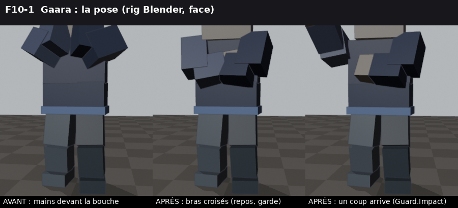
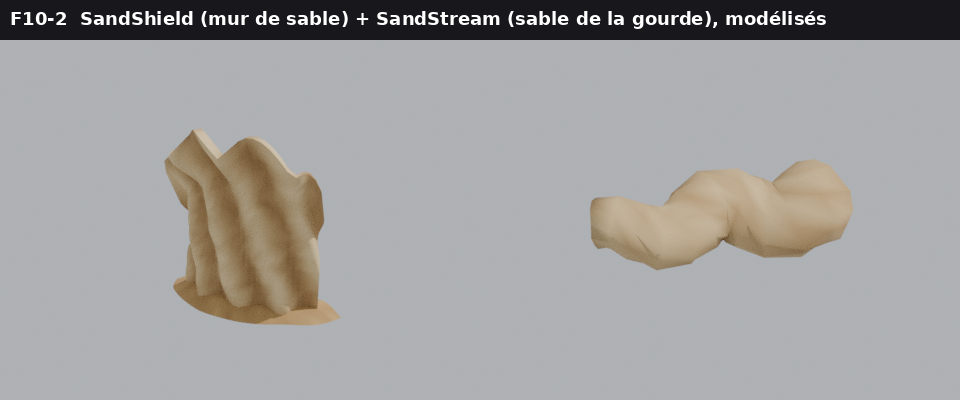

# FILM10 Minato vs Gaara — corrections avant tournage (14/11)

Réponse à `claude/qa-combats-2026-11-14` / `FILM10_avant_tournage.md` (planches F10-1, F10-2, A9).

## F10-1 Gaara : bras croisés

L'ancien « bras croisés » (raise 62, twist 44, elbow 122) mettait les avant-bras à la verticale, les poings devant la bouche. Nouveau pli (référence : examen chūnin contre Lee, ép. 48-50) : les bras le long des côtes, tournés vers l'intérieur, les avant-bras à plat sur le bas de la poitrine.

- `Sand.Idle` et `Sand.Guard` (garde tenue, rien n'arrive) : bras croisés. C'est le sable qui garde, pas ses bras.
- `Sand.Guard.Impact` : quand un coup arrive vraiment, **une** main monte, ouverte vers le coup (le geste qui envoie le sable), puis se replie. La garde levée, c'est seulement ce moment.
- Marche, course et sauts : les jambes et le corps validés sont gardés ; seuls les bras prennent le pli.
- Script : `tools/blender/job_gaara_film10.py`. Modules : `AuthoredClips59-60`.

## F10-2 Le bouclier de sable

- `SandShield` (modélisé, `fx_models.py`) : une nappe de sable courbe qui se dresse entre lui et le coup, avec des coulées et une crête qui roule, sur un pied de sable. Elle jaillit en 0,09 s.
- `SandStream` : la corde de sable qui sort de la gourde vers le mur.
- Un kunai, un kunai marqué ou un shuriken bloqué reste **planté** dans le sable 0,5 s, puis bascule et tombe à ses pieds. Côté serveur, `Combat` passe `thrown` = le type d'objet bloqué dans l'impact `sandshield`.
- Les charges sont des cordes de sable qui tournent autour de la gourde, plus des billes.
- Un coup qui casse le bouclier fait éclater le mur en grains.
- Sans les modèles, l'ancien arc de flux reste dessiné.

## A9 Les pieds qui glissent
Mesuré sans Studio : vitesse du pied posé, en studs par seconde.

| Moment | Avant | Après |
|---|---|---|
| Demi-tour sur place, 180° en 0,3 s (Minato) | 3,5 | 0,3 |
| Demi-tour en garde (Gaara) | 2,2 | 0,4 |
| Arrivée après téléportation | pas croisant l'arène | pied posé sur place |
| Garde portée à 10 studs/s (#92) | 10 | 1,4 |

- Debout (immobile ou en garde), les pieds tiennent le sol. Quand un demi-tour emmène un pied à plus d'un demi-stud de sa place, il fait un pas, levé d'au moins 18 cm.
- Un corps qui saute de plus de 3 studs (téléportation) repart à zéro : ses pieds ne viennent plus de l'ancien emplacement.
- Un cycle joué à une autre vitesse que celle de l'animation garde aussi son pied posé. Les pieds de la locomotion ont leur propre mémoire, séparée de celle des coups.

Tests : `tests/BodyRange.spec` (6 PASS). Il n'y a pas d'avant/après en jeu : ND-DEV-candidat était en Play, utilisé par quelqu'un d'autre, et je ne l'ai pas dérangé.
