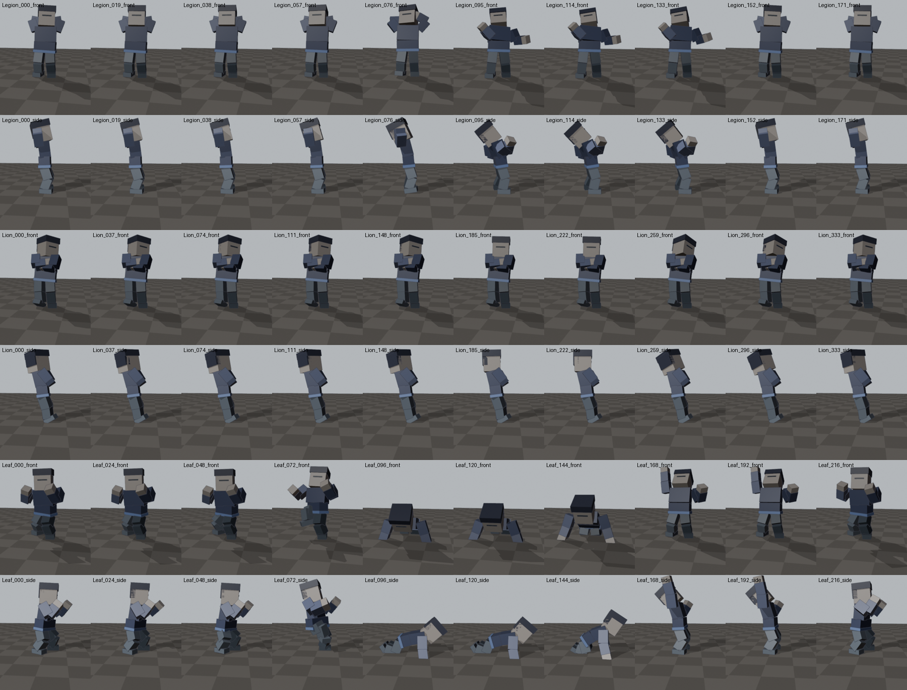

# Humeurs des inspirations à la porte de Konoha (DEC-041, 14/11)

Trois boucles jouées par `Client/HubMoods` sur les modèles des maîtres, à la place des poses de code. Elles sont faites dans `tools/blender/job_moods.py` et écrites dans `AuthoredClips62` et `AuthoredClips63`. Elles doivent se lire d'un coup d'œil à 15-20 studs.

- **Mood.Legion (Naruto, 2,9 s)** : il fait le malin et ne tient pas en place.
  - Mains derrière la tête, coudes écartés (position mesurée : mains juste au-dessus de la nuque et 0,45 derrière, coudes 1,4 sur les côtés) ; il sautille sur les talons et balance les hanches.
  - À chaque boucle, il avance d'un pas, pose le pouce sur sa poitrine (« le prochain Hokage, c'est moi »), l'autre main sur la hanche, menton levé, sourire de côté, puis remet ses mains derrière la tête.
- **Mood.Lion (Sasuke, 5,7 s)** : il boude, à l'écart.
  - Adossé en arrière, bras croisés serrés (avant-bras à plat sur les côtes), le poids sur la jambe gauche, le pied droit croisé devant sur la pointe, la tête tournée.
  - Un coup d'œil vers le nouveau venu, tenu un temps, puis le menton se relève et part de côté (« hmph »).
- **Mood.Leaf (Lee, 3,7 s)** : il s'entraîne à fond.
  - Deux une-deux depuis la garde, un coup de pied haut.
  - Il descend faire deux pompes, se relève et lance le poing au ciel (« YOSH! »).

`HubMoods.authored(id)` lit `Mood.<id>` dans les clips d'auteur. Les lignes Right/Left des clips sont les moteurs RightShoulder/LeftShoulder. Les poses de code restent si le clip manque.

**À vérifier dans Studio** (rien n'a été vu en jeu) :
- la lecture à 15-20 studs depuis la caméra du joueur ;
- les pompes de Lee, qui se lisent bien de profil mais moins de face ;
- Sasuke : son dos ne s'appuie sur rien si la place n'a ni mur ni poteau derrière lui.
