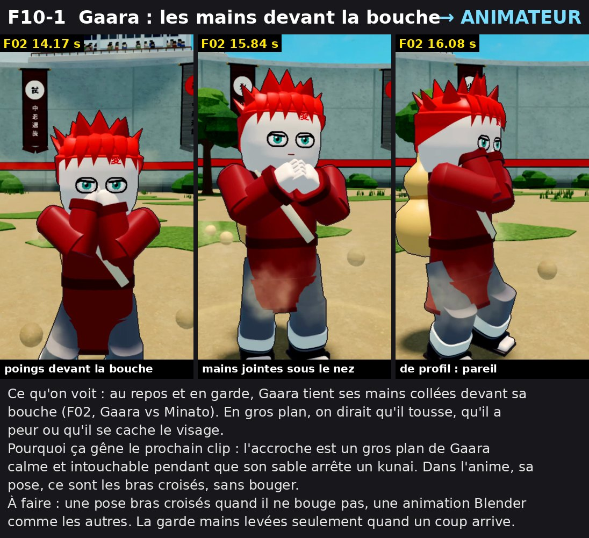
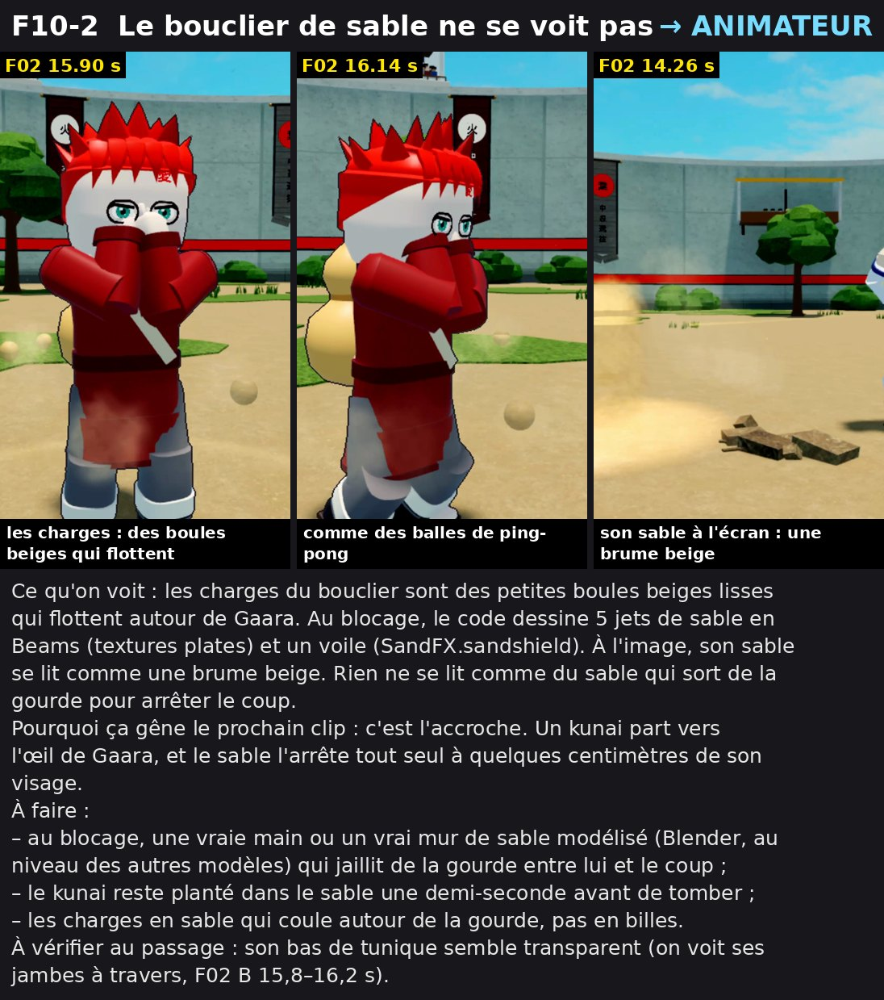

# FILM10 Minato vs Gaara : à corriger avant le tournage (14/11, 17 h 30)

**De :** CM · **Pour :** ANIMATEUR (points 1 à 3) et DEV (point 3)

Le prochain clip est une chorégraphie Minato contre Gaara. Son histoire : le sable de Gaara arrête tout, de face et sur les flancs, mais jamais dans le dos (`Combat` : `SandShield`, `Cover -0.4`). Minato se téléporte dans son dos, puis le Rasengan.

François veut ce combat **sans bug visible**. On corrige donc avant de tourner. Les images viennent du combat Gaara vs Minato de la revue (F02, avant vos corrections #92 et #93).

## 1. Gaara : les mains devant la bouche (ANIMATEUR)

## 2. Le bouclier de sable ne se voit pas (ANIMATEUR)

## 3. Les pieds qui glissent (ANIMATEUR et DEV)
C'est la planche [A9](A9_glisse_sans_marcher.jpg), que ni #92 ni #93 n'ont traitée.

Dans ce clip, ça touche trois moments :
- le bond en arrière de Minato après ses deux coups ;
- Gaara qui se tourne ;
- Minato qui se pose après la téléportation.

À faire : un pied posé ne bouge pas. Pas d'ajustement quand le perso se déplace en garde ; atterrissage sans glisse.

## Ce que je vérifierai à la répétition (dernière version, beta-finale-candidat + #92)
Pas besoin d'y toucher avant, sauf si vous savez déjà que c'est faible :
- la teinte quand le sable bloque (#92 a corrigé la teinte de coup : vérifier aussi celle de garde, dorée) ;
- l'arrivée de Minato dans le dos (`Flashstep.LightningStrike.Arrive`) et son coup ;
- le Cercueil de sable qui se referme sur le vide ;
- le Rasengan dans le dos, son impact, Gaara projeté puis sa retombée (cratère à plat depuis #92) ;
- Minato qui s'arrête au contact sans entrer dans Gaara (D6, #93).

Je vous envoie une image de chacun de ces moments après la répétition, puis je tourne.
