# QA : 6 vrais combats IA contre IA, annotés à l'œil (14/11/2026)

**De :** CM · **Pour :** DEV (planches D) et ANIMATEUR (planches A)

J'ai fait jouer 6 combats IA contre IA dans la place FILM (pr85, version d6b748a). Chaque combat a été rejoué au ralenti (×4) sous 2 angles : A, une caméra de côté ; B, le réalisateur qui suit l'action.

| Combat | Personnages |
|---|---|
| F01 | Sasuke vs Itachi |
| F02 | Gaara vs Minato |
| F03 | Naruto vs Kakashi |
| F04 | Lee vs Itachi |
| F05 | Neji vs Minato |
| F06 | Sasuke vs Kakashi |

Les secondes indiquées sont celles du match.

Chaque planche suit le même plan : ce qu'un joueur voit, pourquoi ce n'est pas logique, et ce qu'il faut faire.

Les rushes en pleine qualité sont sur le Mac, dans `Documents/NinjaDuel/MEDIA/QA_COMBATS_2026-11-14/rushes/`.

**Réponse attendue de chacun :** ce qui est corrigé (PR, et une preuve avant/après dans ND-DEV) et ce qui reste.

## Pour le DEV

### D1. Des coups qui touchent sans toucher
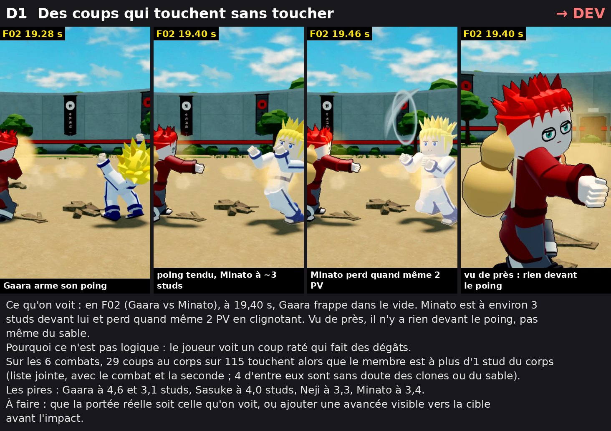

**Liste complète :** [`D1_liste_coups_sans_contact.txt`](D1_liste_coups_sans_contact.txt). 29 coups au corps sur 115 touchent avec plus d'1 stud entre le membre et le corps.

### D2. Phoenix Flower : les dégâts arrivent avant le feu
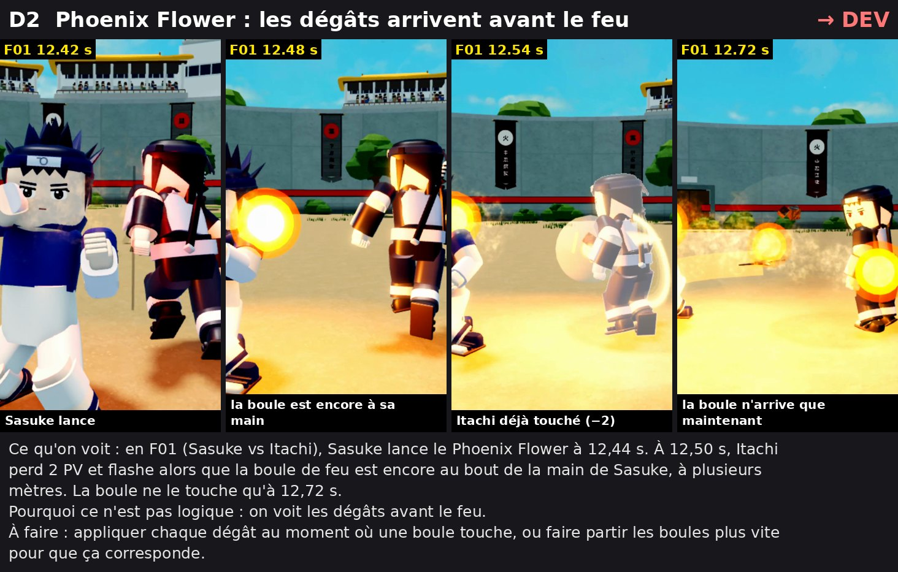

### D3. Les deux corps se rentrent dedans
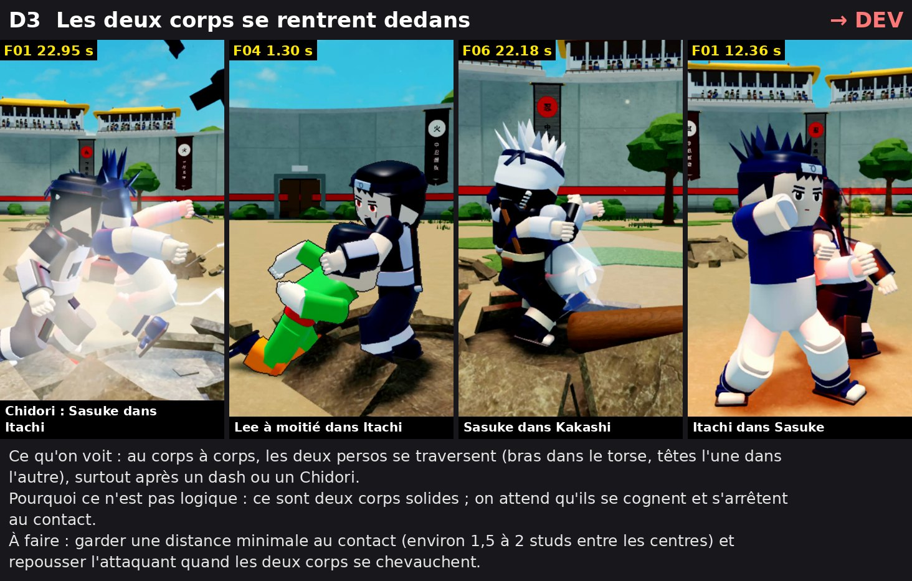

### D4. Le combat commence avec les débris du précédent
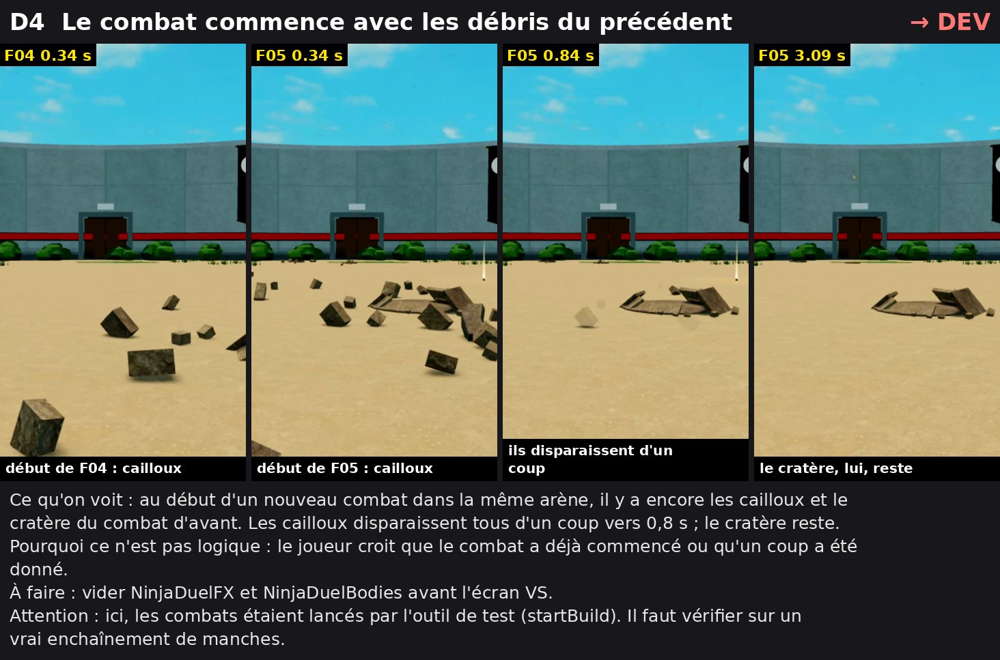

### D5. IA : 4 à 5 s sans rien faire au début
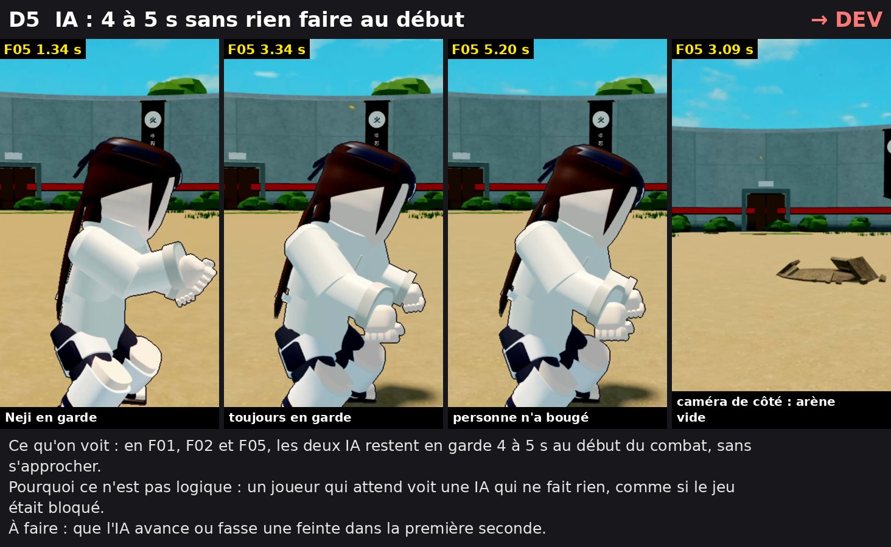

### Causes trouvées dans le code (points A2, A3 et A6, à régler avec l'animateur)

- **A2, les « poteaux noirs ».** `MotionSmear.streaks()` crée des Parts de 0,05 × 2 à 4 × 0,05 avec `CFrame.new(position)`, sans rotation. Elles sont donc toujours verticales, et leur couleur `GHOST` (26, 26, 36) est presque noire.
- **A3, le « fantôme blanc ».** Le Highlight `HitTint` de `VfxKit.tint` a :
  - `FillColor` = (255, 244, 236), presque blanc ;
  - `FillTransparency` entre 0,44 et 0,53, vérifié dans le replay de F06 à 20,70 s.

  Le commentaire du code dit pourtant « rouge sur un coup ».
- **A6, le mur de clones.** C'est le nombre de clones à l'écran en même temps.

**Rappel :** MeshKit affiche « Failed to create empty EditableMesh … memory budget » à chaque Play.

## Pour l'ANIMATEUR

### A1. Lee : la fissure sort du sol comme un mur
C'est l'exemple de François : « la fissure qui devrait être au sol est dans les airs ».

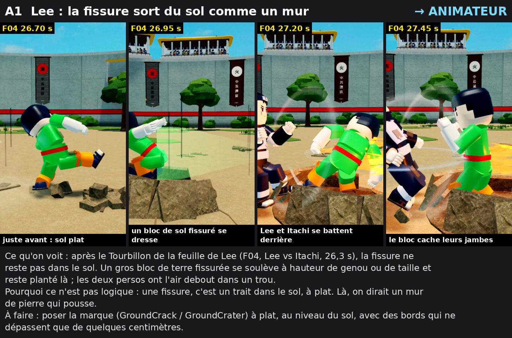

### A2. Les traits de vitesse sont des poteaux noirs verticaux
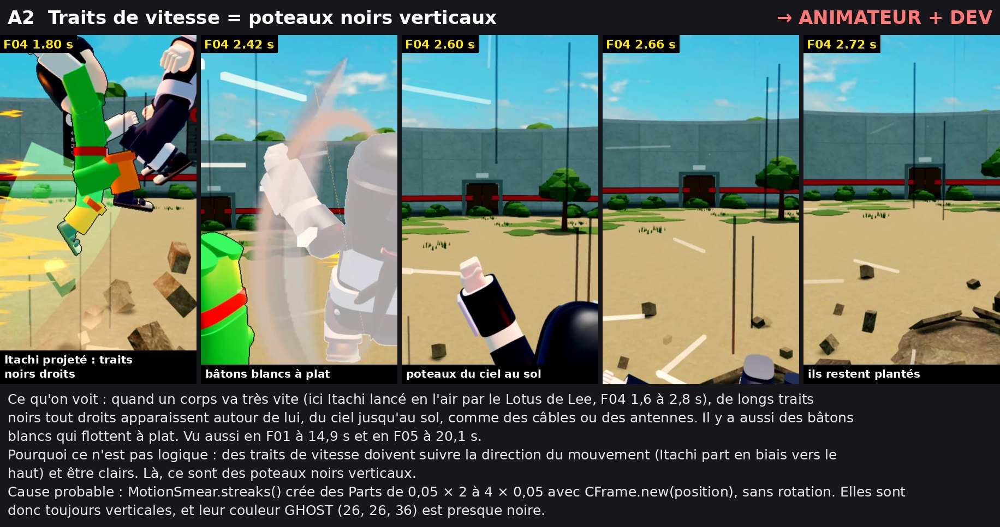

### A3. Le perso touché devient un fantôme blanc
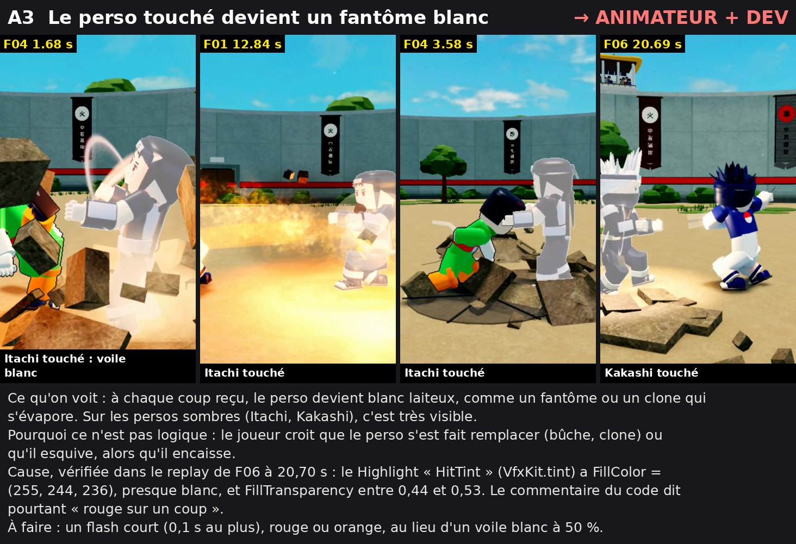

### A4. Des débris géants devant la caméra ou en l'air
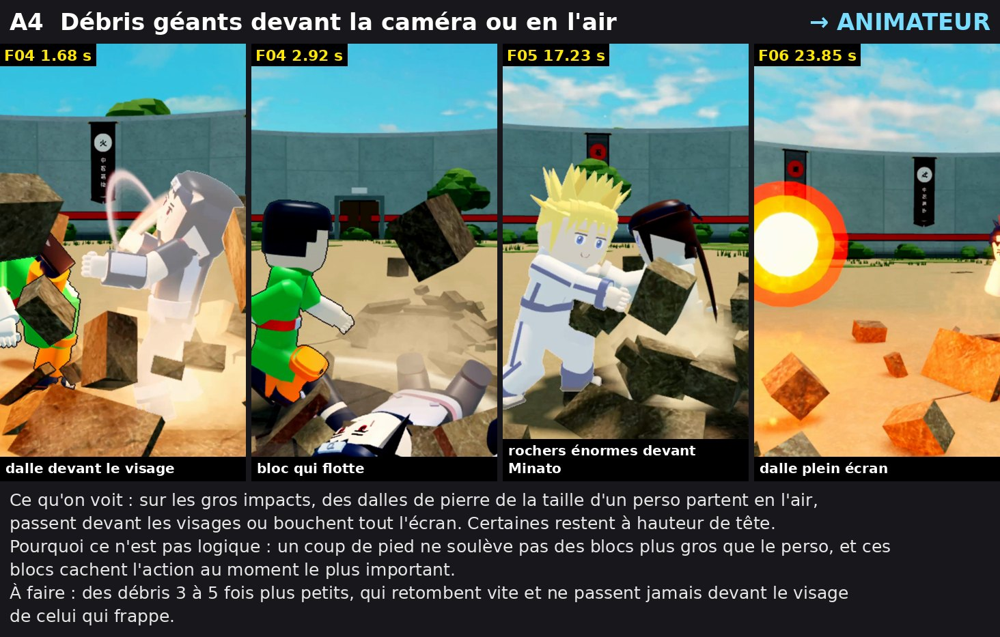

### A5. Des carrés noirs dans le ciel après le feu
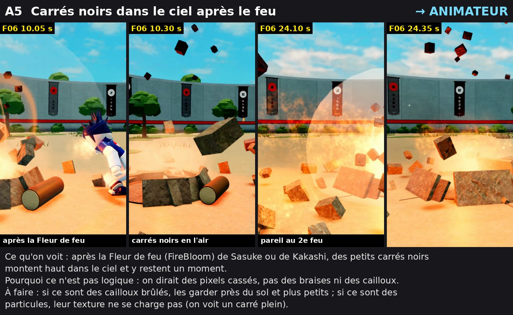

### A6. Naruto : le mur de clones cache tout
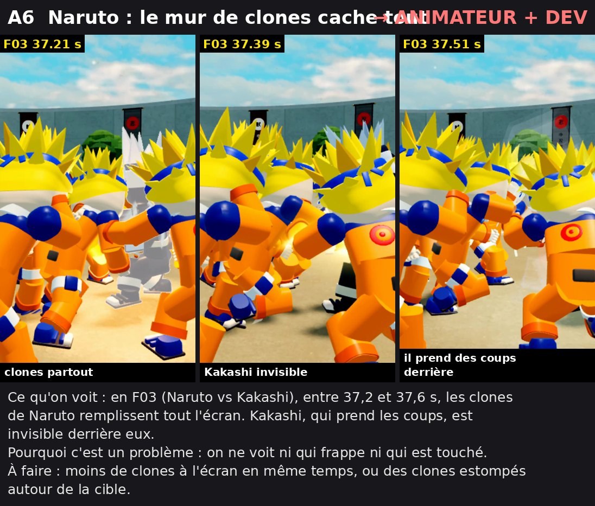

### A7. Un bloc de « verre » autour du perso qui fonce
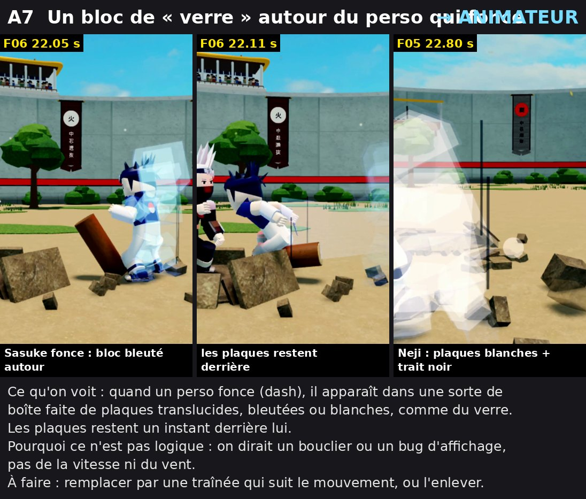

## Corps et physique (ajout du 14/11, 14 h)

Cette passe répond à une remarque de François. La première revue parlait des effets, mais pas de ce qu'on voit le plus : des mouvements qu'un corps ne peut pas faire et des coups qui ne tapent pas avec une vraie physique.

Méthode :
- tout le combat F06 a été mesuré dans le replay, image par image (angles de chaque articulation, pieds au sol, réaction à chaque coup) ;
- les pires moments ont été regardés, au ralenti ou en image fixe du replay.

Les chiffres complets, avec les secondes, sont dans [`D6_mesures_F06.txt`](D6_mesures_F06.txt).

### D6 (DEV). Coup en course : il rentre dedans, puis les deux se repoussent
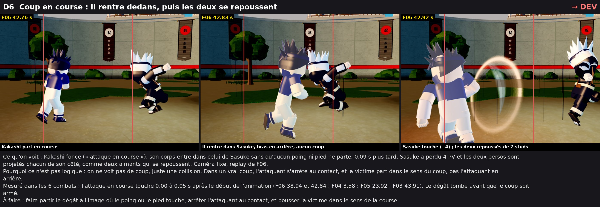

### D7 (DEV). Touché par un perso qui lui tourne le dos, puis attiré vers lui
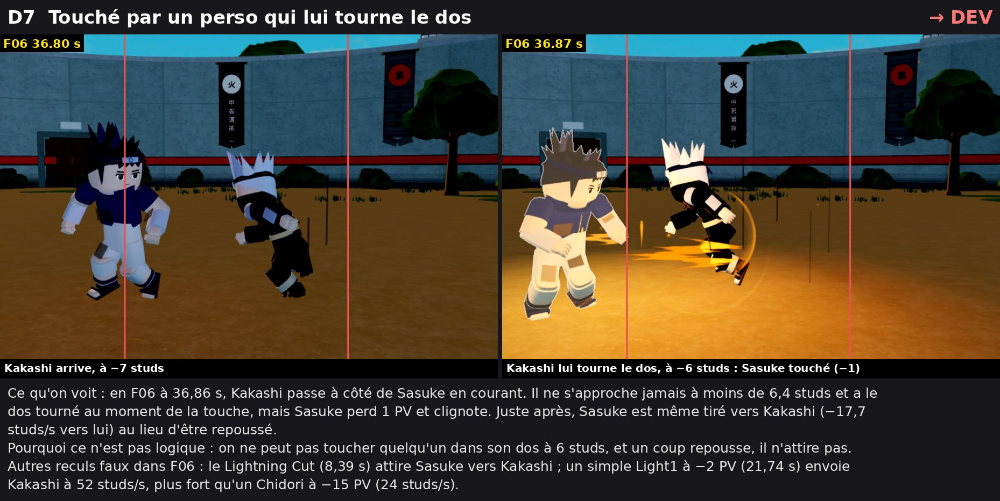

### A8 (ANIMATEUR). Des articulations qu'un corps ne peut pas faire
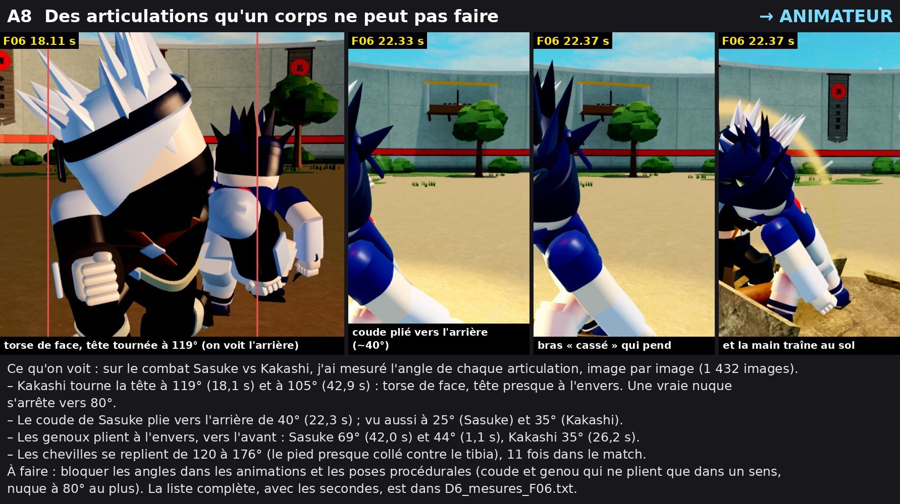

### A9 (ANIMATEUR et DEV). Ils glissent sans marcher
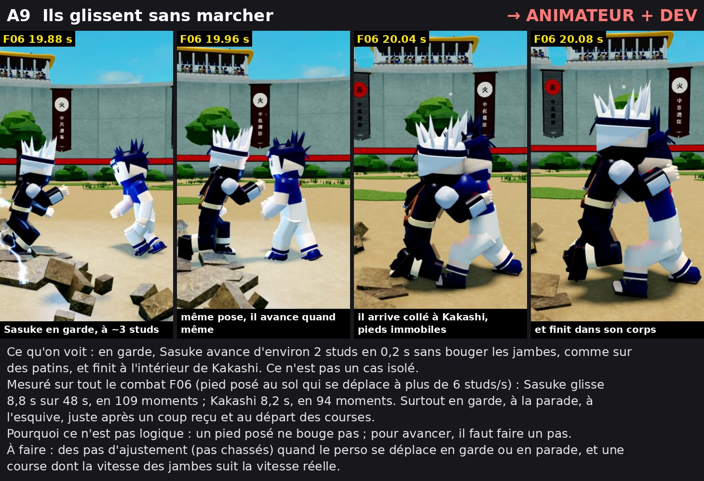

## Écartés : ces défauts viennent de nos outils de tournage, pas du jeu

- La caméra de côté perd parfois les deux persos et filme une arène vide.
- Le réalisateur entre dans un débris (écran gris) ou fige l'image pendant le Chidori. L'autre passe, au même instant, est normale.
- Le −1 PV de F06 à 20,66 s vient d'un kunai lancé, pas d'un coup de poing.
