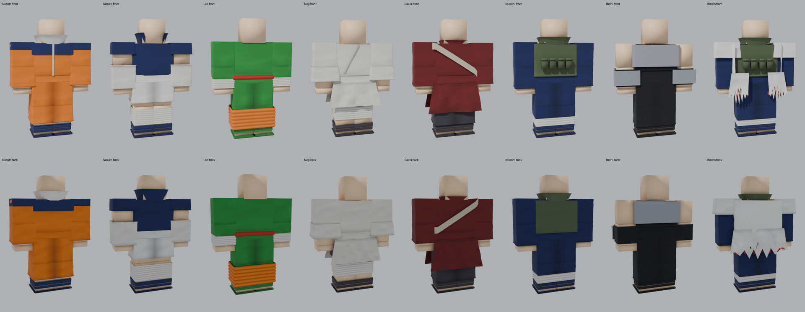
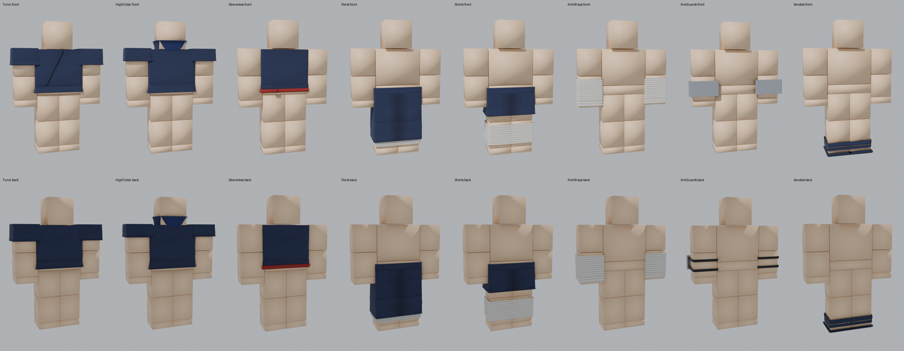
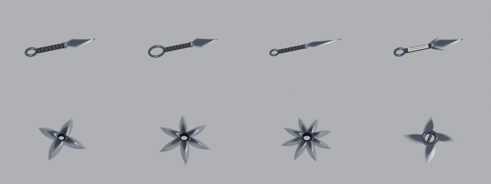

# Tenue ninja sur l'avatar : modèles Blender (DEC-040, 14/11)

Demande du DEV : les vêtements modélisés de la tenue ninja, ajustés au corps R15 standard du jeu, une pièce par partie du corps et par slot de couleur.

## Ce qui est livré
- `tools/blender/outfit_models.py` : 16 modèles.
  - 8 pièces gratuites : tunique de genin, col montant, haut sans manches, pantalon noué, short bandé, bandages de bras, protège-bras, sandales.
  - 8 tenues des maîtres : Naruto, Sasuke, Lee, Neji, Gaara, Kakashi, Itachi (ANBU), Minato.
- `src/Shared/OutfitMeshes.luau` + `OutfitMeshData1..13`, au format packé de MeshKit (comme HubMeshData) :
  - `Items[id de la Boutique]` donne le modèle ; les variantes de couleur partagent un modèle (la tunique en 3 couleurs, le pantalon en 2, les sandales en 2).
  - `Models[modèle]` est la liste des pièces `{on=<partie R15>, slot=<slot de couleur>, …}`.
  - `Ref[partie]` est la taille de référence de la partie R15 standard.
  - `NewSlots` liste les slots qui n'ont pas encore de couleur dans `Shared/Shop` : Minato `Coat`, `Flame`, `Vest` ; Lee `Wrap`.
- **Pas de logos** : pas d'emblème Uchiha, pas de spirale, pas de masque ANBU. Silhouettes de 12 à 14 ans (Partie I).
- **Pose en jeu.** Chaque pièce est modélisée autour du centre de sa partie, à la taille `Ref[partie]`. À l'exécution :
  - taille = `taille du maillage × body.Size / Ref[partie]` ;
  - soudure à `body.CFrame * CFrame.new(o × body.Size / Ref[partie])` ;
  - `Color` = `colors[slot]` de l'objet de la Boutique, qui se multiplie avec les couleurs de sommets (de l'ombrage seulement, entre 0,45 et 1).
- **Armes cosmétiques** (`fx_models.py`, `Client/MeshData`) : `KunaiRing` (lame large, grand anneau, poignée longue), `KunaiLong` (kunai de lancer fin), `Shuriken6`, `Shuriken8`. Elles s'ajoutent à `Kunai`, `MarkedKunai`, `Shuriken` (4 branches) et `FumaShuriken`.
- Tests : `tests/OutfitMeshes.spec`, 3 PASS. Ils vérifient que chaque objet porté de la Boutique a son modèle, que chaque pièce va sur une vraie partie R15 avec un slot coloré, qu'elle se décode, qu'elle reste près de sa partie, et que les pièces gauche/droite sont symétriques. `Models.spec` vérifie aussi les nouvelles armes.

## Références (Partie I), vérifiées le 14/11
- **Naruto** : survêtement orange, épaules et haut du dos bleus, grand col blanc montant zippé, bandes au tibia, sandales bleues.
- **Sasuke** : haut bleu marine à manches courtes et col très haut ouvert, manchettes blanches du coude au poignet, short blanc, tibias bandés.
- **Lee** : combinaison verte, jambières orange roulées, ceinture rouge, avant-bras bandés.
- **Neji** : chemise-robe écrue à manches longues et pans jusqu'aux cuisses, short sombre, bandages.
- **Gaara** : long manteau rouge sombre jusqu'à mi-cuisse, sangle beige en travers du torse, pantalon sombre.
- **Kakashi** : haut et pantalon bleu marine, veste tactique verte à poches et col montant, tibias bandés.
- **Itachi (ANBU)** : haut noir, plastron gris, protège-avant-bras métalliques.
- **Minato** : haut bleu marine, veste tactique verte, manteau court blanc ouvert devant, flammes rouges à l'ourlet.

## Limites
- **Avatars non blocky.** Sur le corps blocky, les deux jambes se touchent : le pantalon forme un seul volume, et l'intérieur des jambes est assombri pour les distinguer. Sur un corps Rthro ou un bundle, la mise à l'échelle par `body.Size` donne le bon encombrement, mais pas la forme exacte.
- **Branchement par le DEV.** Côté serveur, il faut construire les EditableMesh puis les cuire (`CreateDataModelContentAsync`), comme MeshKit, ou bien les publier comme le village (#97).
- **Rien vu dans Studio** (aucune place ouverte). Les images sont des rendus Blender sur un mannequin R15 en boîtes.
