# Relevé des écrans — avant la passe commune 1

Place : place commune d0678d90 (890f237a), copie LAB, release. Écran : fenêtre Studio 1334 × 590, clavier et souris, nouveau joueur. 21 écrans, **0 lignes rouges** (0 client, 0 serveur), 7 orange, 45 remarques.

## La sortie, regroupée

| Niveau | Côté | Genre | Ligne | Fois |
|---|---|---|---|---|
| orange (avertissement) | client | maillages (budget mémoire) | `Failed to create empty EditableImage that was requested due to reaching memory budget limits. (9 fois)` | 1 |
| orange (avertissement) | client | maillages (budget mémoire) | `Failed to create empty EditableMesh that was requested due to reaching memory budget limits. (30 fois)` | 1 |
| orange (avertissement) | client | script | `Player:Move called, but player currently has no character.` | 1 |
| orange (avertissement) | client | script | `[VfxHit] coups « animé moderne » éteints, l'ancien rendu reste : off: 4 images not served` | 1 |
| orange (avertissement) | client | script | `[AwakenFX] images Roblox does not serve, built-in stand-ins used (9 images)` | 1 |
| orange (avertissement) | server | chargement d'asset | `ContentId: rbxassetid://#, #, #, # failed due to: User is not authorized to access Asset. (répété)` | 1 |
| orange (avertissement) | server | chargement d'asset | `ContentId: rbxassetid://# failed due to: Request asset was not found` | 1 |

## Écran par écran

### 1. Chargement

*Comment* : début du Play
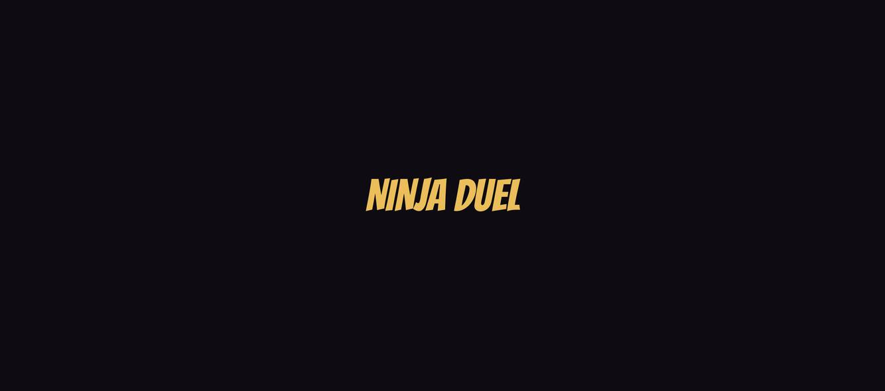
- orange (avertissement) (client) : `Failed to create empty EditableImage that was requested due to reaching memory budget limits. (9 fois)`
- orange (avertissement) (client) : `Failed to create empty EditableMesh that was requested due to reaching memory budget limits. (30 fois)`
- orange (avertissement) (client) : `Player:Move called, but player currently has no character.`
- orange (avertissement) (client) : `[VfxHit] coups « animé moderne » éteints, l'ancien rendu reste : off: 4 images not served`
- orange (avertissement) (client) : `[AwakenFX] images Roblox does not serve, built-in stand-ins used (9 images)`
- orange (avertissement) (server) : `ContentId: rbxassetid://18341956985, 18342045122, 18341905406, 18342131933 failed due to: User is not authorized to access Asset. (répété)`
- orange (avertissement) (server) : `ContentId: rbxassetid://81504106 failed due to: Request asset was not found`

### 2. Arrivée à Konoha

*Comment* : 8 s après le début
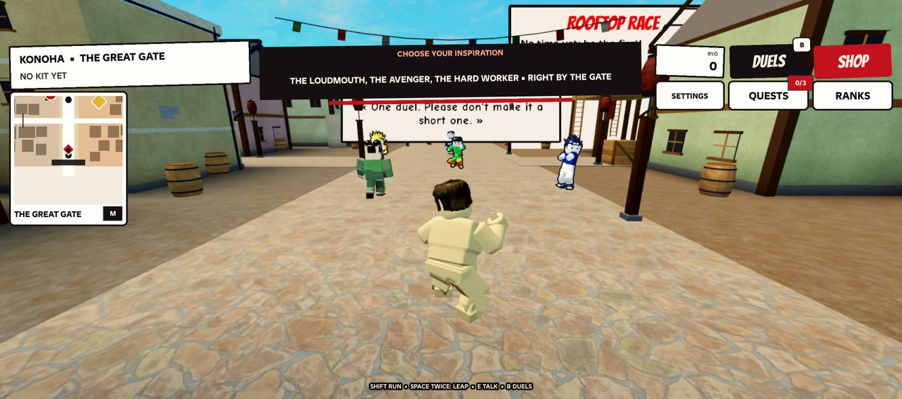
- Le bandeau noir CHOOSE YOUR INSPIRATION cache le haut du milieu : le panneau ROOFTOP RACE et la bulle du passant passent dessous.
- Aucun bouton ne dit PLAY ; la carte du lieu dit NO KIT YET.
- Le personnage est un corps crème uni.
- La minicarte reste dans son cadre (corrigée le 23/11).

### 3. DUELS (premier choix)

*Comment* : touche B (un clic sur DUELS aussi)
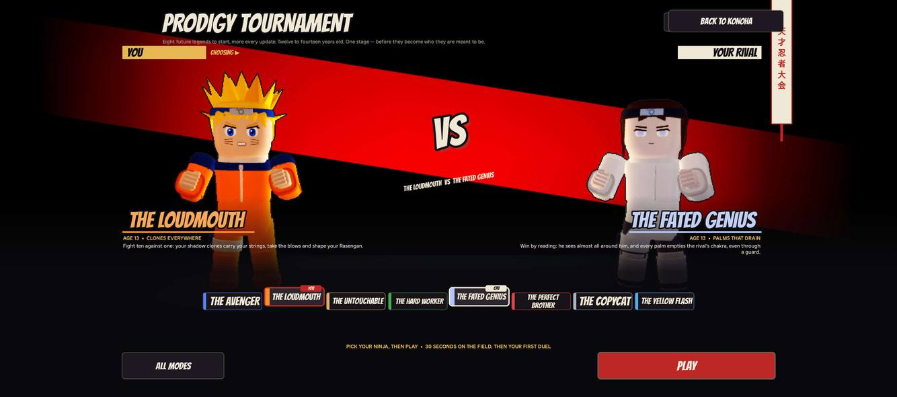
- Le bouton BACK TO KONOHA chevauche le bouton CONTROLS (TAB) et la bannière verticale 天才忍者大会 le recouvre à droite.
- Une seule action claire : PLAY. « 30 SECONDS ON THE FIELD, THEN YOUR FIRST DUEL ».

### 4. Premier duel

*Comment* : PLAY
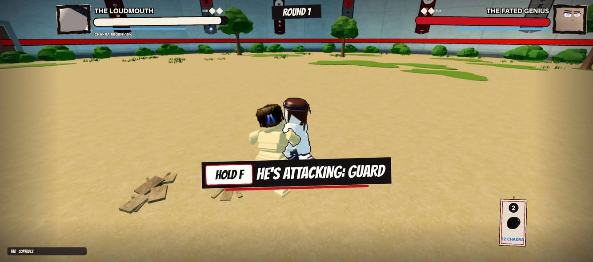
- Le portrait du joueur, en haut à gauche, est un cadre blanc vide.
- La carte de technique « 2 » est seule ; « 22 CHAKRA » dépasse du bord de la carte.
- La consigne HOLD F HE'S ATTACKING: GUARD se lit bien.

### 5. Victoire du premier duel

*Comment* : le duel joué jusqu'au K.O.
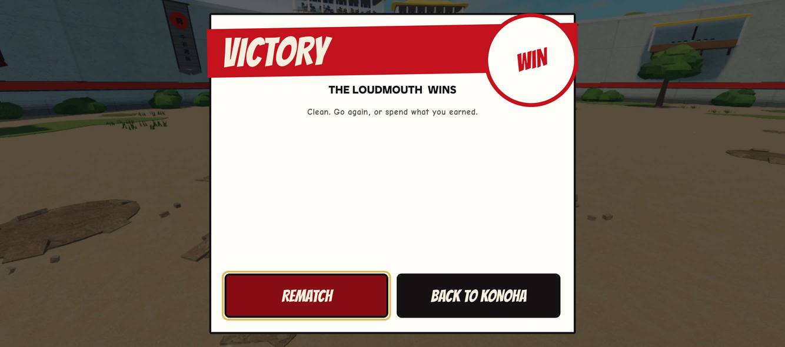
- Le milieu de la fenêtre est vide : rien sur ce qu'on a gagné, alors que le texte dit « spend what you earned ».
- Les Ryō restent à 0 après cette victoire.

### 6. YOUR NINJA (tenue)

*Comment* : BACK TO KONOHA : l'écran s'ouvre seul
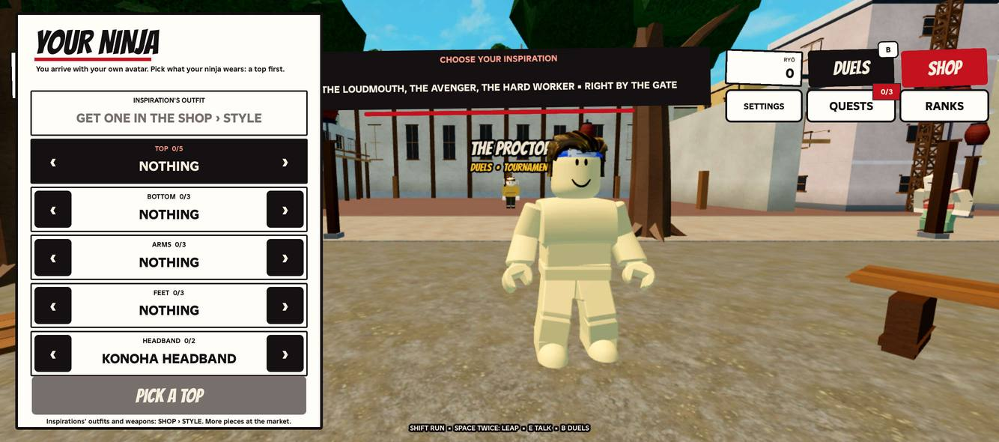
- Le bandeau CHOOSE YOUR INSPIRATION reste par-dessus.
- Le bouton du bas est gris (PICK A TOP) tant qu'on n'a pas choisi de haut.

### 7. Le premier haut

*Comment* : › sur TOP
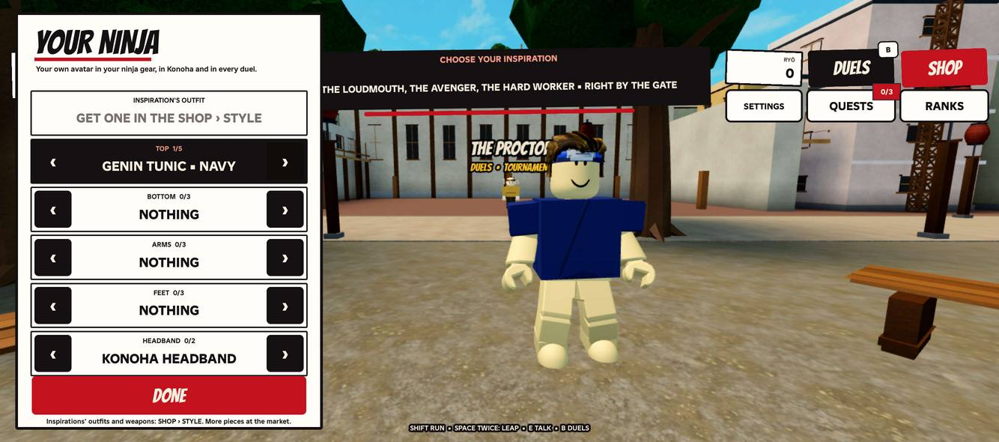
- La tunique GENIN TUNIC est une boîte bleue posée sur le torse, bras nus : c'est « les habits du début sont moches » (refaits par l'ANIMATEUR, e9d9bc64).
- La flèche › de la ligne TOP, sombre sur fond sombre, se voit à peine.

### 8. Konoha après la tenue

*Comment* : DONE
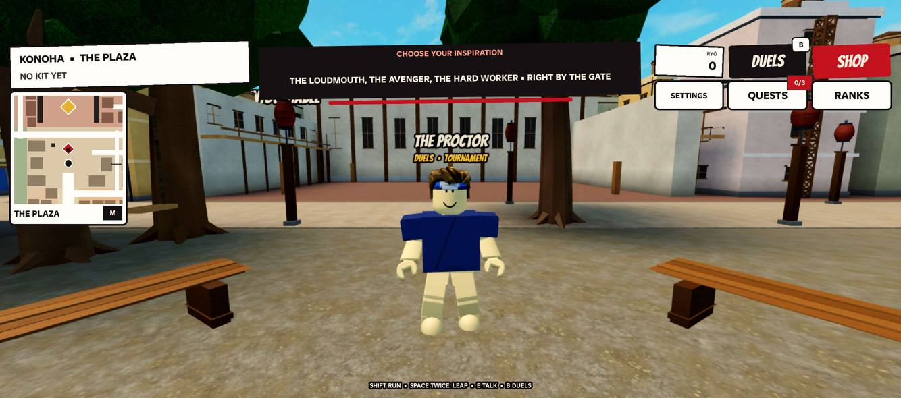
- Toujours NO KIT YET et 0 Ryō après le premier duel.
- Le bandeau d'inspiration cache une enseigne de la place.

### 9. SHOP, les kits

*Comment* : SHOP
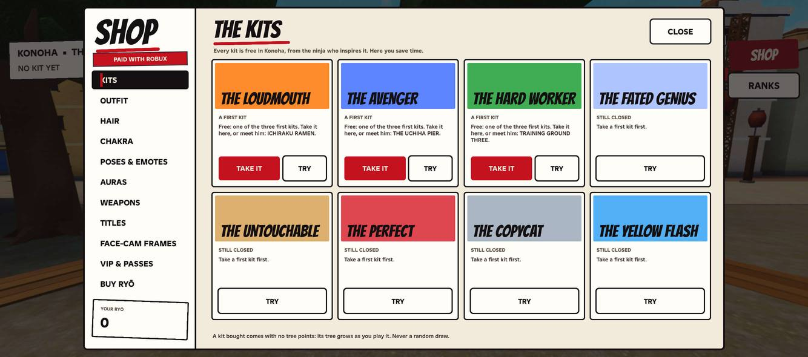
- Le titre rouge PAID WITH ROBUX est au-dessus des kits, qui sont gratuits.
- THE PERFECT BROTHER est coupé en « THE PERFECT ».
- Les cartes de kit n'ont qu'une bande de couleur : aucun portrait.
- Le trait rouge de l'onglet choisi cache la première lettre (« |ITS »).

### 10. TRY THIS KIT

*Comment* : TRY sur THE LOUDMOUTH
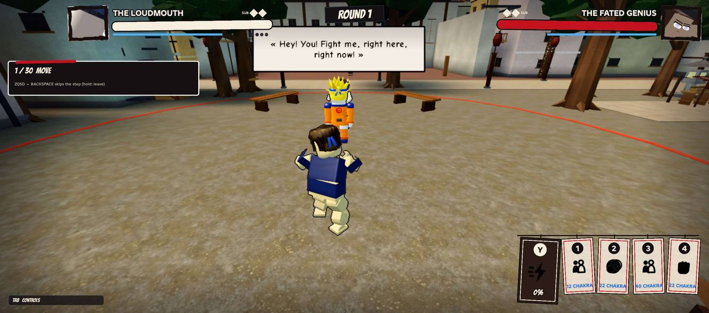
- L'essai se joue sur la place, 30 étapes (« 1/30 MOVE »).
- Le haut de l'écran annonce THE LOUDMOUTH contre THE FATED GENIUS, mais l'adversaire a l'apparence de Naruto, et le joueur garde son corps crème.
- La bulle du passant (« Hey! You! Fight me… ») couvre ROUND 1 et le haut des barres de vie.
- L'essai dit ZQSD, les réglages disent WASD ; en AZERTY, Q (esquive) et Z (chakra) sont aussi des touches de marche.
- Les textes « 12 CHAKRA », « 40 CHAKRA » dépassent des cartes.

### 11. QUESTS

*Comment* : QUESTS (après avoir quitté l'essai : Retour arrière tenu)
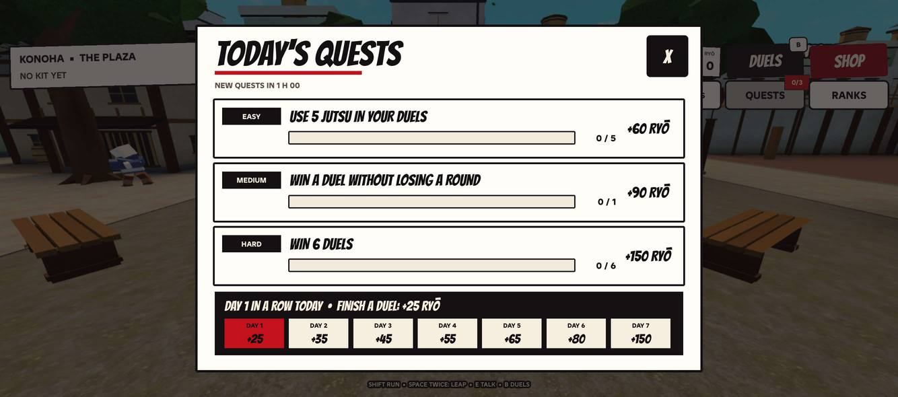
- « Day 1 in a row today • finish a duel: +25 Ryō », mais le premier duel n'a rien donné.

### 12. RANKS

*Comment* : RANKS
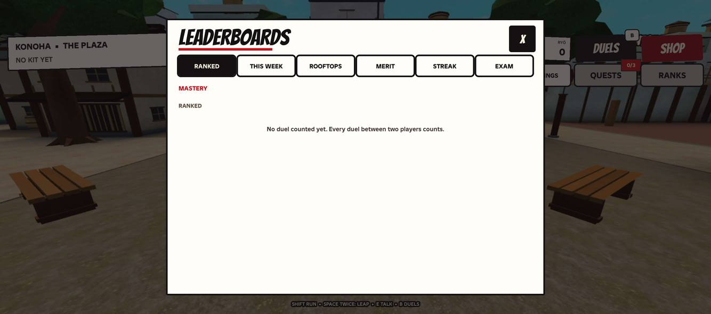
- Vide dans Studio (pas de DataStore) : rien à juger ici.

### 13. SETTINGS

*Comment* : SETTINGS
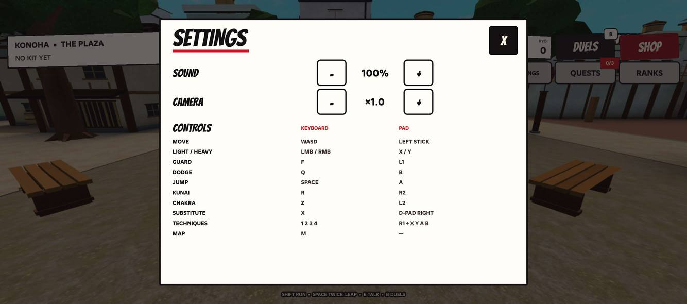
- Les touches affichées (WASD, Q esquive, Z chakra) ne sont pas celles de l'essai du kit (ZQSD).

### 14. La carte (M)

*Comment* : touche M
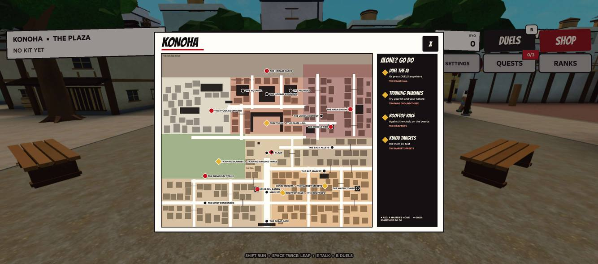
- Des noms de lieux se chevauchent ou sont coupés (MAIN ST sous ROOFTOP RACE, THE TEA, la tour des Hokage).
- Les textes de la carte et la légende sont minuscules.

### 15. Touche G (émote)

*Comment* : touche G
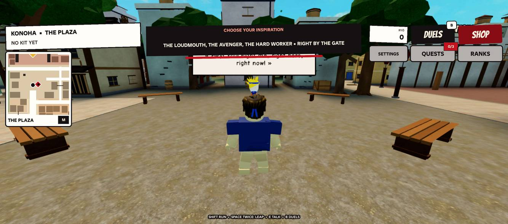
- Rien ne s'ouvre : aucune émote possédée, et rien ne le dit.
- La bulle du passant est cachée par le bandeau d'inspiration, avec le trait rouge en travers du texte.

### 16. SHOP, OUTFIT

*Comment* : SHOP › OUTFIT
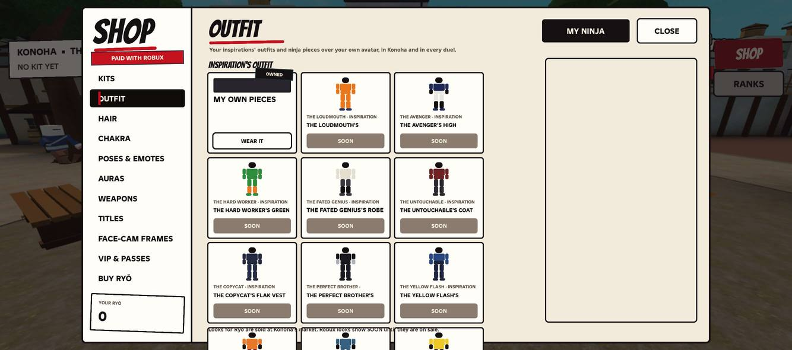
- Toutes les tenues disent SOON ; les images sont des pictogrammes, pas les rendus.
- Le grand cadre d'aperçu à droite est vide.
- La phrase du bas (« Looks for Ryō are sold at Konoha's market… ») passe sur la rangée de cartes suivante.

### 17. SHOP, VIP & PASSES

*Comment* : SHOP › VIP & PASSES
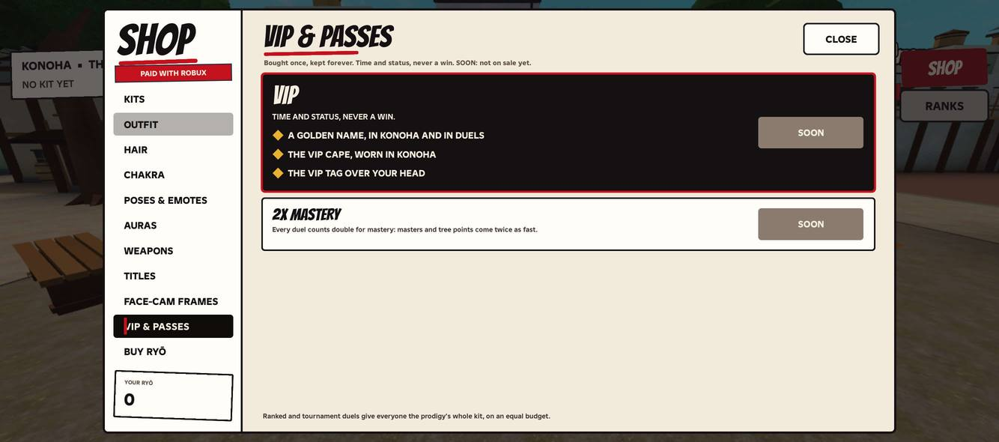
- Deux onglets ont l'air choisis : OUTFIT reste en gris.
- Pas d'image pour le VIP ni pour 2X MASTERY.

### 18. DUELS, après le premier duel

*Comment* : touche B
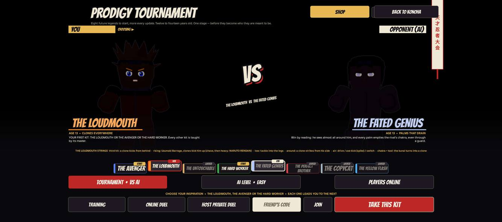
- Les deux combattants sont presque noirs à l'ouverture de l'écran.
- Trois rangées de boutons ; THE PERFECT BROTHER est caché sous son étiquette LOCKED.
- L'action principale s'appelle TAKE THIS KIT, puis ENTER THE STAGE.

### 19. Le kit pris

*Comment* : TAKE THIS KIT
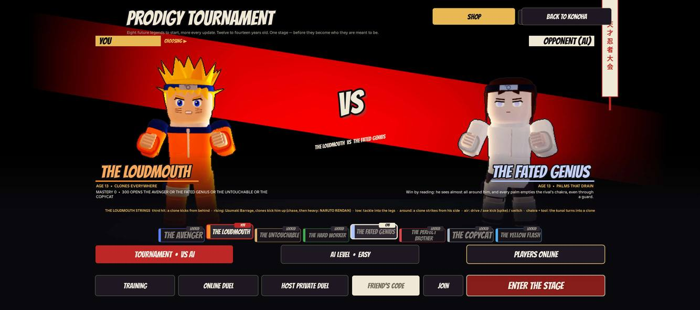
- Les deux autres kits de départ passent à LOCKED : le choix est définitif, et l'écran ne l'a pas dit avant.

### 20. Duel contre l'IA (sur la place)

*Comment* : ENTER THE STAGE
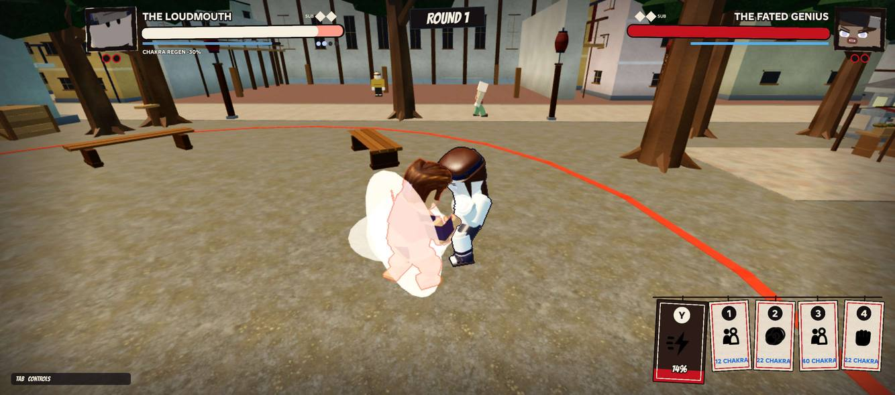
- Le corps du joueur est un fantôme blanc et rosé (la caméra du duel l'efface quand il est entre elle et l'adversaire).
- Le joueur avec le kit Naruto n'a pas sa tenue : elle est en Robux, SOON.

### 21. Défaite 0-2

*Comment* : le duel joué jusqu'au bout
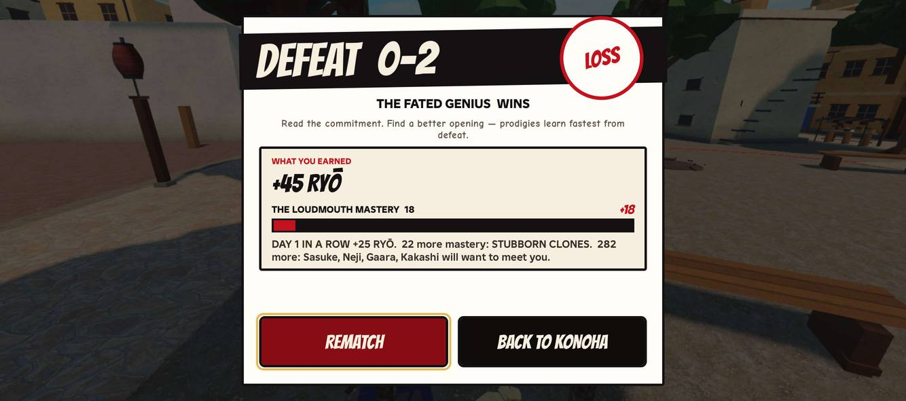
- Celui-ci dit ce qu'on a gagné (+45 Ryō, maîtrise +18) : c'est ce qui manque à la victoire du premier duel.

