# Relevé des écrans — après la passe commune 1

Place : PLACES/NinjaDuel.rbxlx (DEC-052), sources db13098f, place commune c40cc16d, profil capture. Écran : fenêtre Studio 1334 × 590, clavier et souris du Play (robloxstudio-mcp), nouveau joueur. 24 écrans, **0 lignes rouges** (0 client, 0 serveur), 7 orange, 52 remarques.

Avant (place commune d0678d90 (890f237a), copie LAB, release) : 21 écrans, 0 lignes rouges, 7 orange, 45 remarques.

*Profil capture (DEC-052) : la pastille « F4 » en haut à gauche et les deux traits rouges verticaux sont l'outil de tournage, pas le jeu. Ils ne se cachent pas depuis le client.*

## La sortie, regroupée

| Niveau | Côté | Genre | Ligne | Fois |
|---|---|---|---|---|
| orange (avertissement) | client | maillages (budget mémoire) | `Failed to create empty EditableImage that was requested due to reaching memory budget limits. (9 fois)` | 1 |
| orange (avertissement) | client | maillages (budget mémoire) | `Failed to create empty EditableMesh that was requested due to reaching memory budget limits. (20 fois ; 30 avant)` | 1 |
| orange (avertissement) | client | script | `Player:Move called, but player currently has no character.` | 1 |
| orange (avertissement) | client | script | `[VfxHit] coups « animé moderne » éteints, l'ancien rendu reste : off: 4 images not served` | 1 |
| orange (avertissement) | client | script | `[AwakenFX] images Roblox does not serve, built-in stand-ins used (9 images)` | 1 |
| orange (avertissement) | client | chargement d'asset | `ContentId: rbxassetid://#, #, #, # failed due to: User is not authorized to access Asset. (répété)` | 1 |
| orange (avertissement) | server | chargement d'asset | `ContentId: rbxassetid://#, #, #, # failed due to: User is not authorized to access Asset. (3 fois)` | 1 |

## Écran par écran

### 1. Chargement

*Comment* : début du Play
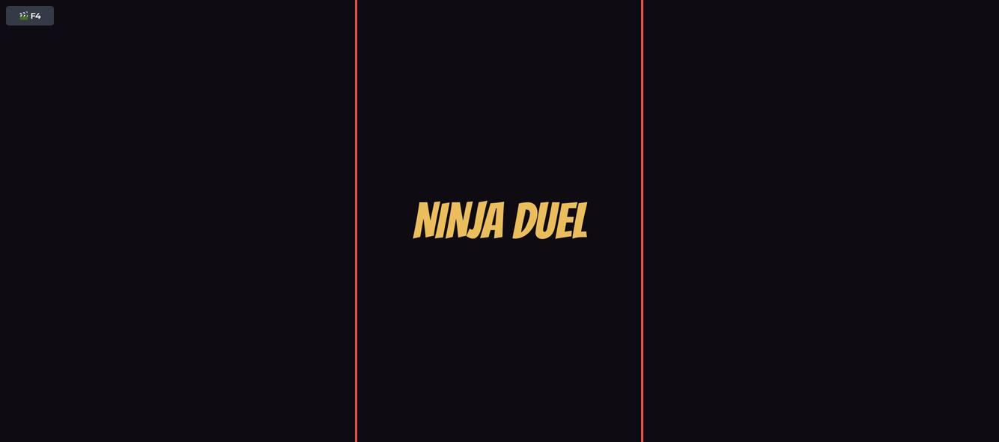
- Inchangé : NINJA DUEL sur fond noir.
- orange (avertissement) (client) : `Failed to create empty EditableImage that was requested due to reaching memory budget limits. (9 fois)`
- orange (avertissement) (client) : `Failed to create empty EditableMesh that was requested due to reaching memory budget limits. (20 fois ; 30 avant)`
- orange (avertissement) (client) : `Player:Move called, but player currently has no character.`
- orange (avertissement) (client) : `[VfxHit] coups « animé moderne » éteints, l'ancien rendu reste : off: 4 images not served`
- orange (avertissement) (client) : `[AwakenFX] images Roblox does not serve, built-in stand-ins used (9 images)`
- orange (avertissement) (client) : `ContentId: rbxassetid://18341956985, 18342045122, 18341905406, 18342131933 failed due to: User is not authorized to access Asset. (répété)`
- orange (avertissement) (server) : `ContentId: rbxassetid://18341956985, 18342045122, 18341905406, 18342131933 failed due to: User is not authorized to access Asset. (3 fois)`

### 2. Arrivée à Konoha

*Comment* : après le chargement
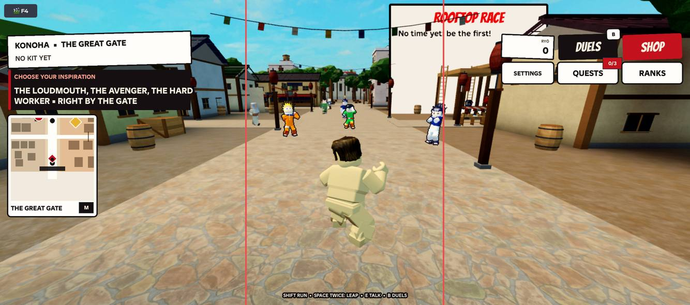
- Corrigé : le but CHOOSE YOUR INSPIRATION ne barre plus le haut de l'écran ; il est sous la boîte du lieu, à gauche, et le milieu montre le village (DESIGN).
- Toujours : aucun bouton PLAY ; NO KIT YET ; le corps est crème uni.
- La minicarte est sous le but, à gauche.

### 3. DUELS (premier choix)

*Comment* : touche B
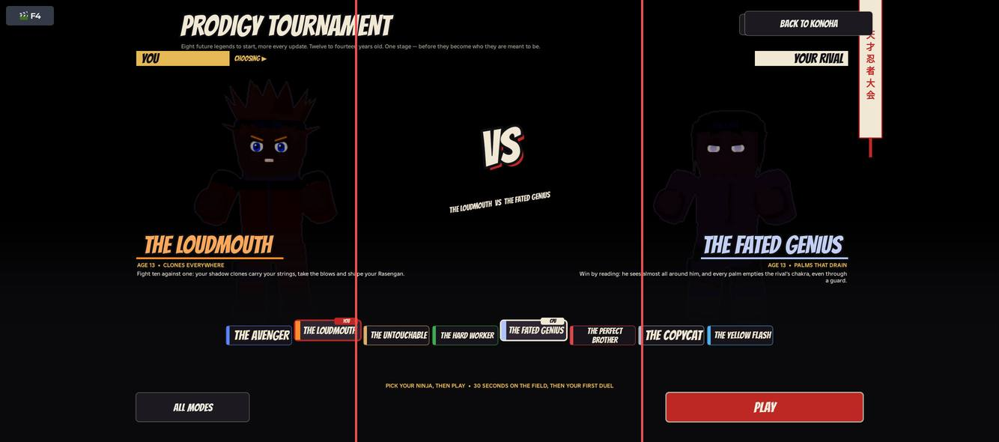
- Changé : le premier DUELS montre tout le tournoi (8 kits, ALL MODES, PLAY) au lieu d'un seul choix.
- Les deux combattants restent presque noirs.
- La bannière verticale 天才忍者大会 recouvre le bout droit de BACK TO KONOHA.
- THE LOUDMOUTH est coupé sous l'étiquette YOU (« THE LOUDMOUT »).

### 4. Premier duel

*Comment* : PLAY
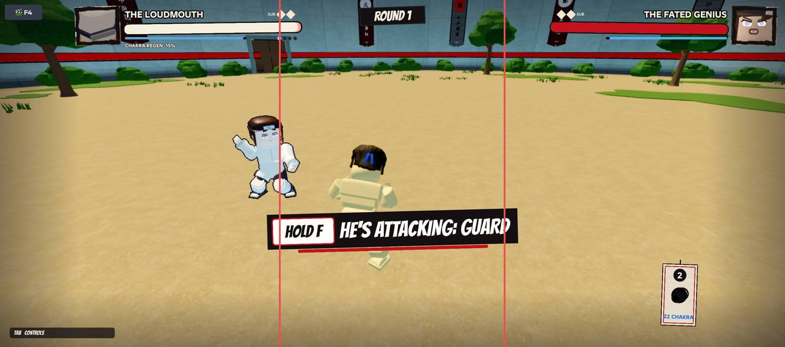
- Le portrait du joueur a une image (un buste crème), plus le cadre blanc vide.
- « 22 CHAKRA » dépasse toujours du bord de la carte 2.
- La consigne HOLD F HE'S ATTACKING: GUARD se lit bien.

### 5. Victoire du premier duel

*Comment* : le duel joué jusqu'au K.O.
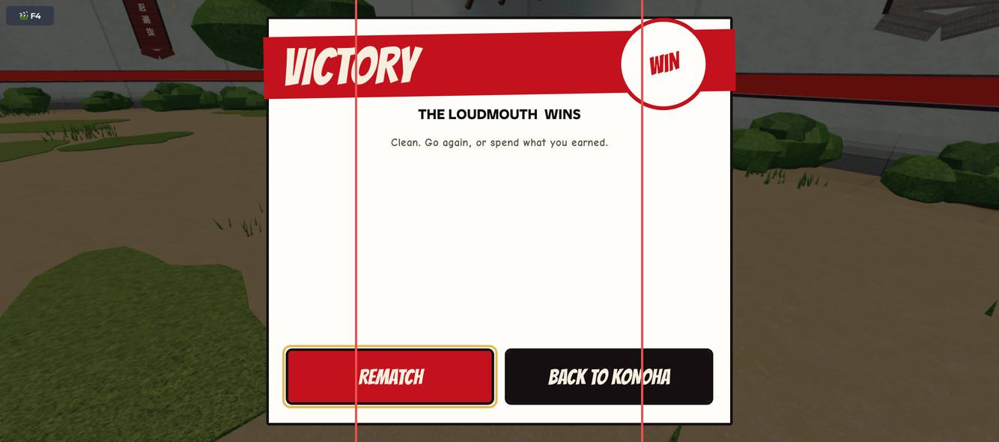
- Inchangé : le milieu est vide, rien sur ce qu'on a gagné ; « spend what you earned » ; les Ryō restent à 0.

### 6. YOUR NINJA (tenue)

*Comment* : BACK TO KONOHA : l'écran s'ouvre seul
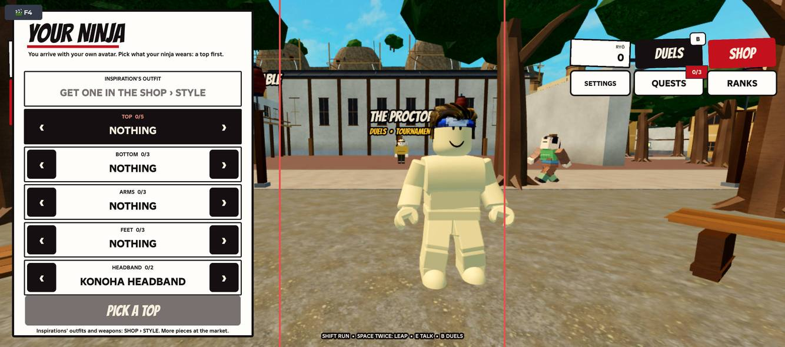
- Corrigé : le bandeau d'inspiration ne passe plus par-dessus.
- Les flèches › des lignes se voient (blanches sur noir).
- TOP 0/5 (5 hauts au lieu de 3) ; le bandeau KONOHA HEADBAND est déjà mis.

### 7. Le premier haut

*Comment* : › sur TOP
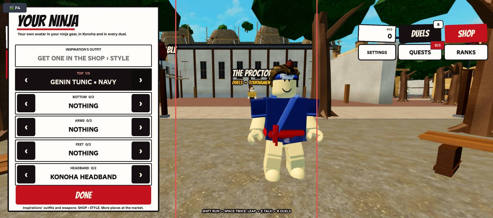
- Changé (ANIMATEUR, e9d9bc64) : la GENIN TUNIC a un revers croisé et une ceinture obi rouge nouée.
- Vue de loin, elle reste une boîte bleue posée sur le torse, bras nus, sans le pantalon (BOTTOM : NOTHING).

### 8. Konoha après la tenue

*Comment* : DONE
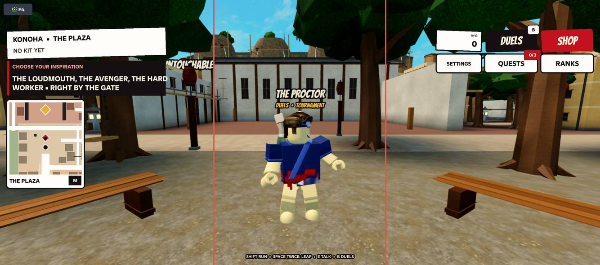
- Toujours NO KIT YET et 0 Ryō après le premier duel.
- Le but dit « RIGHT BY THE GATE » alors qu'on est sur la place.
- Le but cache à moitié une enseigne de la place (« …NTOUCHABLE »).

### 9. SHOP, les kits

*Comment* : SHOP
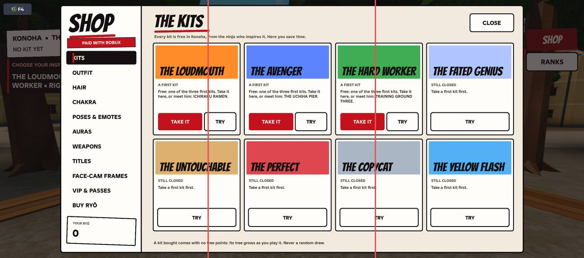
- Inchangé : PAID WITH ROBUX au-dessus des kits gratuits ; THE PERFECT BROTHER coupé en « THE PERFECT » ; pas de portrait ; le trait de l'onglet choisi cache la première lettre (« |ITS »).

### 10. TRY THIS KIT

*Comment* : TRY sur THE LOUDMOUTH
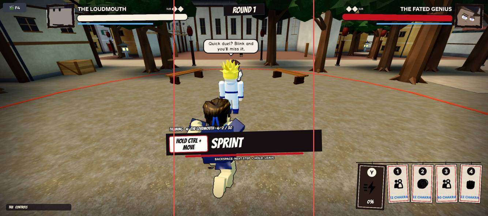
- Corrigé (DESIGN) : les étapes sont dans la légende du coach, une à la fois (TRAINING • THE LOUDMOUTH • 2 / 30, la touche, BACKSPACE: NEXT STEP • HOLD: LEAVE).
- Corrigé : la bulle du passant est au-dessus de sa tête, plus sur ROUND 1.
- L'adversaire a des cheveux jaunes en pointe et une tenue blanche, alors que le haut de l'écran et son portrait disent THE FATED GENIUS.
- Le sprint de l'essai dit HOLD CTRL + MOVE ; Konoha dit SHIFT RUN.
- « 12 CHAKRA » et « 40 CHAKRA » dépassent toujours des cartes.

### 11. QUESTS

*Comment* : QUESTS (après avoir quitté l'essai : Retour arrière tenu)
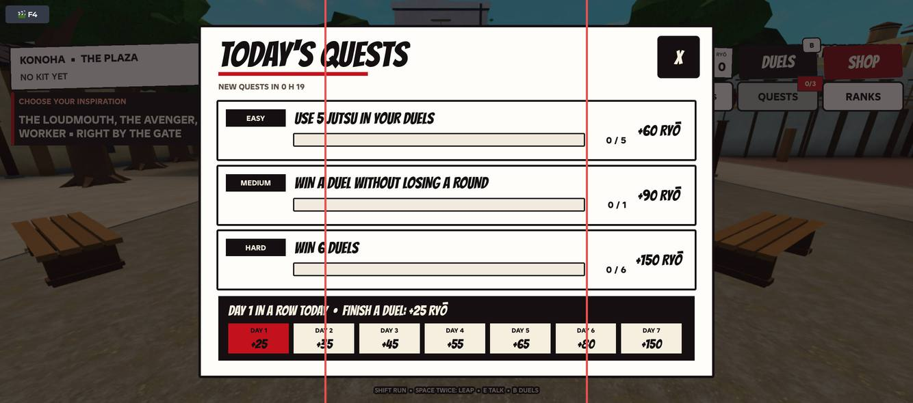
- Inchangé : « Day 1 in a row • finish a duel: +25 Ryō », mais le premier duel n'a rien donné ; WIN A DUEL WITHOUT LOSING A ROUND reste à 0/1 après la victoire 2-0 du premier duel.

### 12. RANKS

*Comment* : RANKS
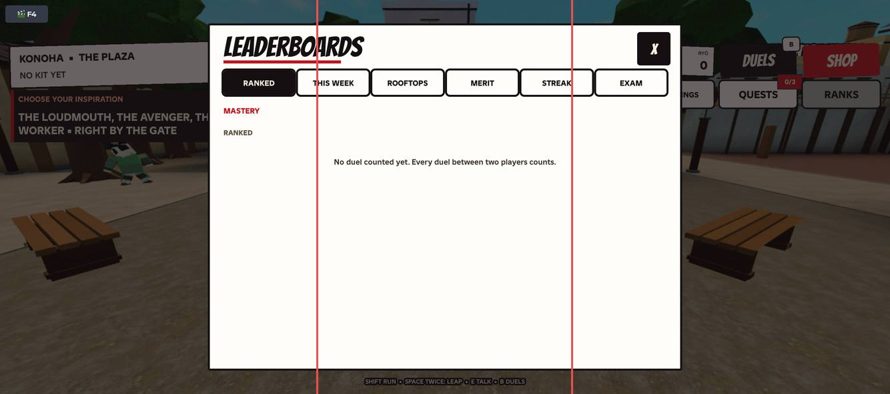
- Nouveau : un état vide qui s'explique (« No duel counted yet. Every duel between two players counts. »).

### 13. SETTINGS

*Comment* : SETTINGS
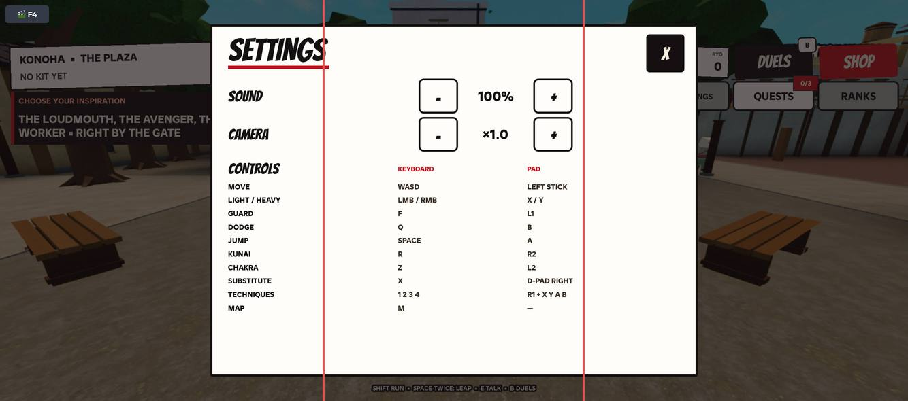
- Inchangé : WASD, Q esquive, Z chakra (en AZERTY, Q et Z sont aussi des touches de marche).

### 14. La carte (M)

*Comment* : touche M
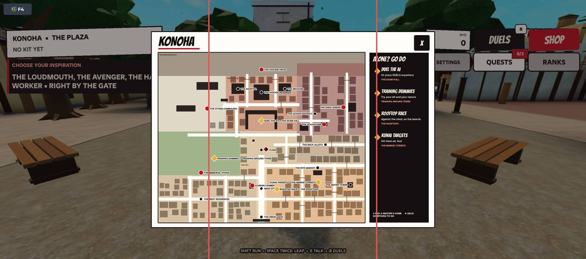
- La nouvelle ville (7c6c9c57) est sur la carte.
- Toujours : des noms se chevauchent ou sont coupés (MAIN ST sous ROOFTOP RACE, THE TEA, le nom au-dessus de THE HOSPITAL), textes et légende minuscules.

### 15. Touche G (émote)

*Comment* : touche G
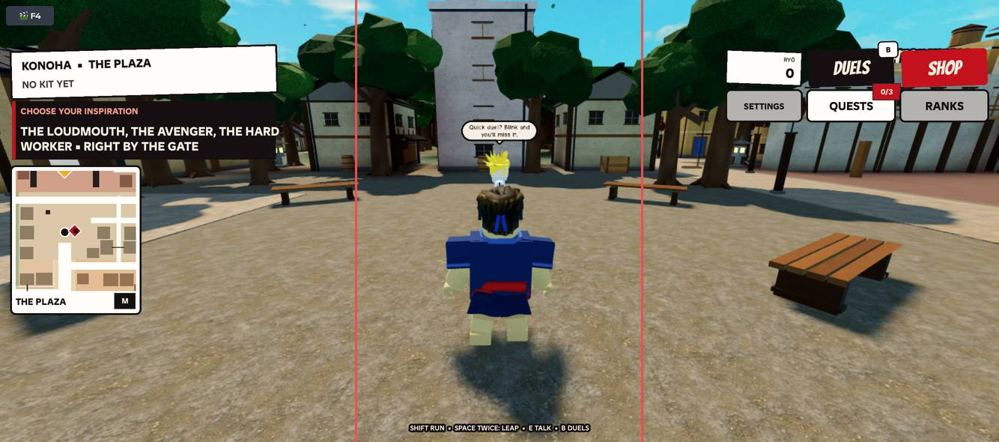
- Inchangé : rien ne s'ouvre, et rien ne le dit.
- Corrigé : la bulle du passant est lisible, au-dessus de sa tête.
- SETTINGS et RANKS restent grisés après leur fermeture, QUESTS non.

### 16. SHOP, OUTFIT

*Comment* : SHOP › OUTFIT
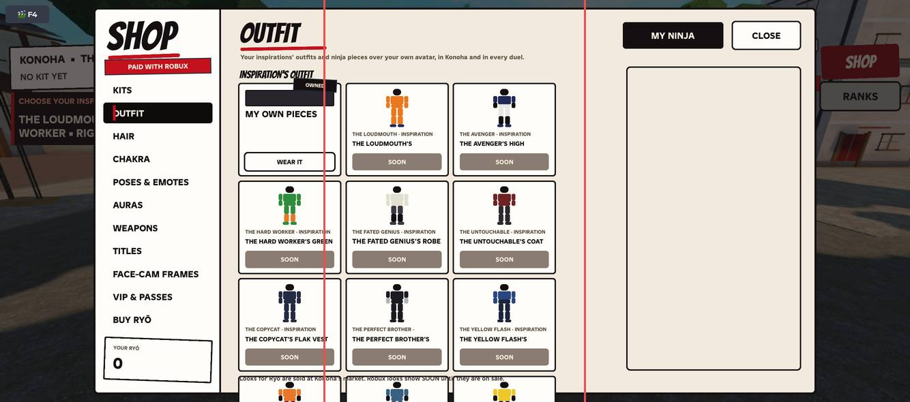
- Nouveau : la carte MY OWN PIECES (OWNED, WEAR IT), avec une image vide.
- Inchangé : les tenues d'inspiration disent SOON, en pictogrammes ; le grand cadre d'aperçu est vide ; la phrase du bas passe sur la rangée suivante.

### 17. SHOP, VIP & PASSES

*Comment* : SHOP › VIP & PASSES
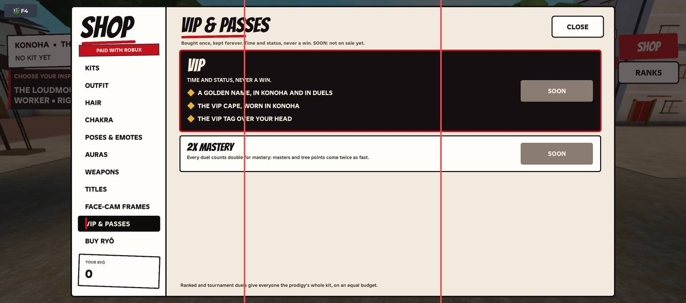
- Corrigé : un seul onglet a l'air choisi.
- Le VIP dit ce qu'il donne (nom doré, la cape VIP, le badge) ; EARLY ACCESS et MORE BUILDS ne sont plus là (DEC-049).
- Toujours pas d'image pour le VIP ni pour 2X MASTERY.

### 18. DUELS, après le premier duel

*Comment* : touche B
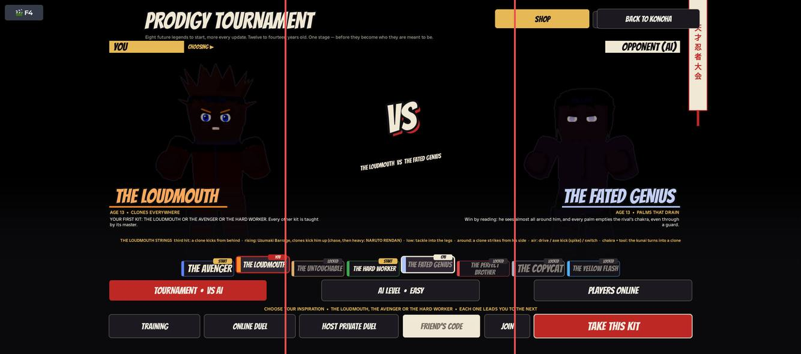
- Inchangé : les combattants presque noirs, trois rangées de boutons, THE PERFECT BROTHER caché sous LOCKED, TAKE THIS KIT puis ENTER THE STAGE.

### 19. Le kit pris

*Comment* : TAKE THIS KIT
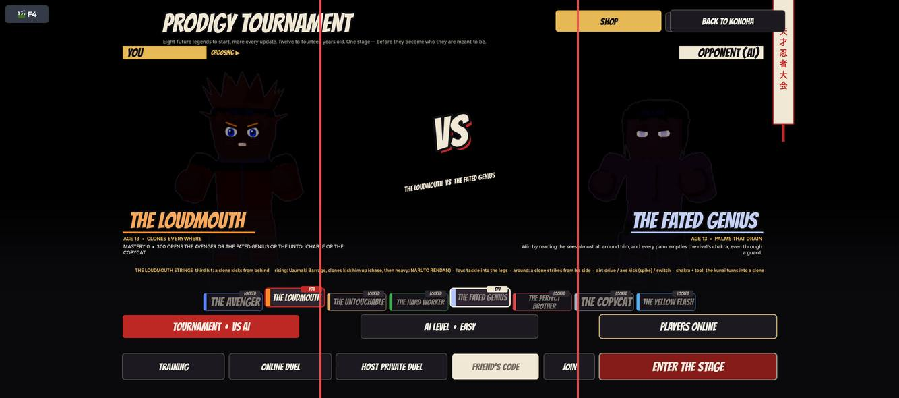
- Inchangé : les deux autres kits de départ passent à LOCKED sans prévenir avant.

### 20. Duel contre l'IA (sur la place)

*Comment* : ENTER THE STAGE
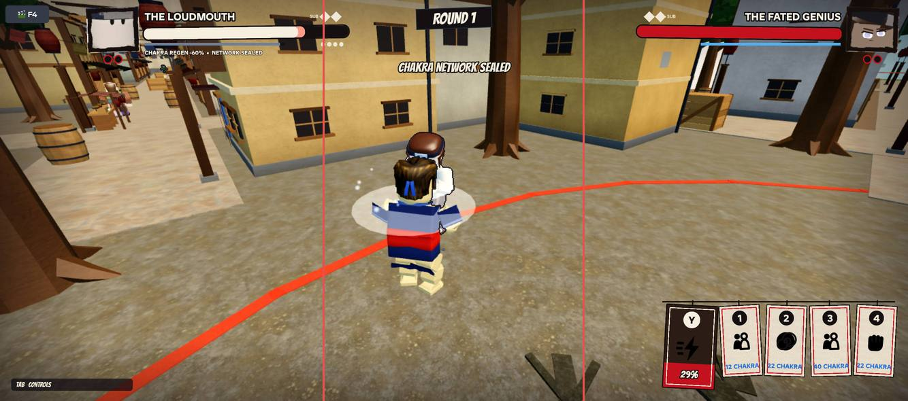
- Le corps du joueur est toujours effacé en fantôme quand il est entre la caméra et l'adversaire.
- Le joueur se bat dans sa tenue (la tunique et l'obi) : le look du kit est en Robux, SOON.
- Le portrait du joueur est un visage blanc presque vide.

### 21. Défaite 0-2

*Comment* : le duel joué jusqu'au bout
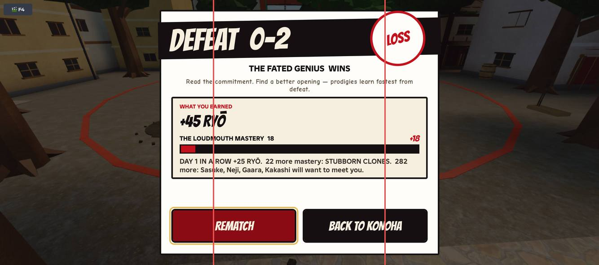
- Inchangé : celui-ci dit ce qu'on a gagné (+45 Ryō, maîtrise +18).

### 22. Le racket (nouveau)

*Comment* : le corps posé à 10 studs d'un voyou
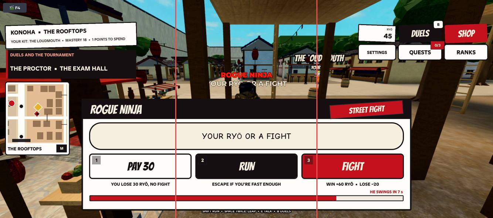
- Nouveau (DEV 9e18d83e, 2e97394d ; DESIGN 30a77ca7) : ROGUE NINJA, PAY 30 / RUN / FIGHT, ce que coûte chaque choix, la mèche (HE SWINGS IN 7 s).
- Le panneau couvre toute la moitié basse : on ne voit plus le voyou, et il cache la ligne des touches (SHIFT RUN…).
- « YOUR RYŌ OR A FIGHT » est écrit deux fois : sur le voyou et dans le panneau.
- En haut à gauche : « 1 POINTS TO SPEND ».

### 23. La mèche finie : le combat

*Comment* : sans réponse en 8 s
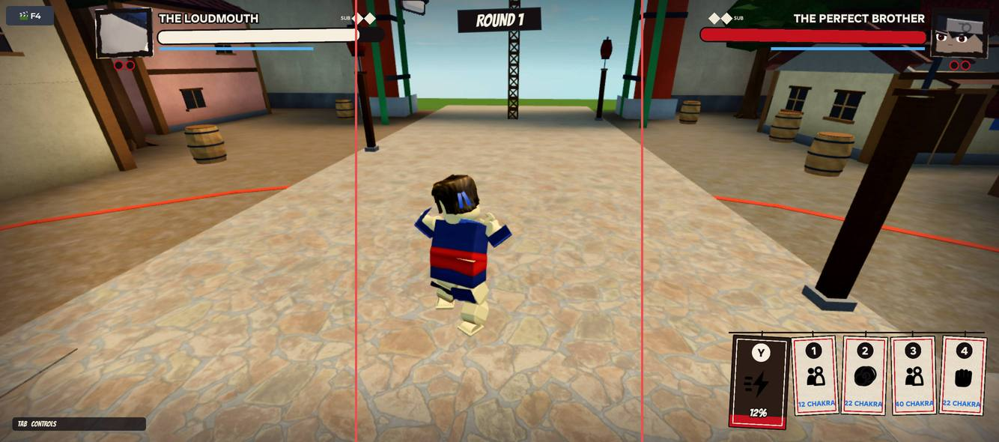
- Le combat de rue part contre THE PERFECT BROTHER ; au premier instant, l'adversaire n'est pas dans l'image.
- Les touches 1, 2, 3 du panneau n'ont pas pu être essayées : le clavier simulé de Studio les refuse (« bound to a CoreGUI core action »). C'est une limite de l'outil ; au vrai clavier, à vérifier.

### 24. Défaite contre le voyou

*Comment* : le combat joué jusqu'au bout
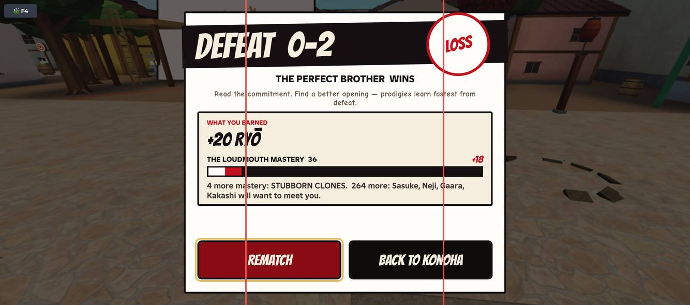
- L'écran dit « WHAT YOU EARNED +20 RYŌ », mais la bourse reste à 45 : le voyou a pris 20 Ryō (la règle du racket), et l'écran ne le dit pas.

